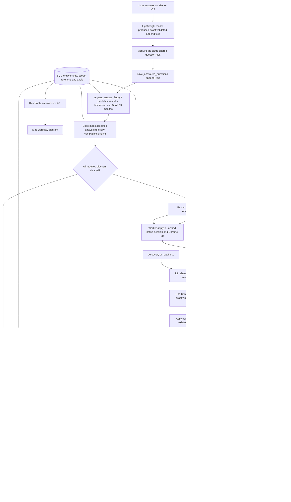

# Three-worker application pool and live Mac diagram

Implementation brief agreed in the backend chat, updated October 25, 2026.
This is a target contract, not a claim about the deployed server.

## Accepted workflow

1. Start with exactly three static application workers. Each owns its application,
   native session, and Chrome tab. Independent applications must not share an
   unsafe mutable browser/session handle. Verify actual transport ownership;
   do not assume three Python threads alone provide independent application state.
2. A paused worker retains its application and checkpoint. Other workers continue.
   Completion makes its slot available for another job. Existing discovery/ranking
   behavior remains independent. No elasticity is required in this first version.
   Chrome has one host-controlled connection at a time. All browser turns,
   including discovery and readiness, enter one durable FIFO before native
   dispatch. Three logical workers retain their own native session and tab.
   Waiting renews the current lease without retrying or consuming failure budget.
   Question matching, answer formatting, and answer writes do not hold Chrome.
   Only a verified terminal browser turn releases its connection. A persisted
   uncertain owner needs an audited stopped-owner recovery; expiry does not clear it.
3. Before applying, a worker loads the current answered-question Markdown snapshot
   and caches the hash from a dedicated manifest. All shared reads/writes use the
   backend's shared question-pool lock.
4. When blocked, the worker acquires that same lock and reads the stored hash.
   If changed, code computes an answer delta and the SAME applying worker judges
   whether those answers resolve its questions. Refresh its snapshot/hash.
5. For remaining questions, the SAME worker matches the current pending pool,
   links existing questions, or creates new questions while holding the lock.
   There is no separate matching agent. Scope and current form bindings must be
   validated. Register the complete known blocker batch before deciding to pause.
6. Pending questions are persisted in a Markdown file. Once answered, remove them
   from the pending view and append them to the answered-question Markdown file.
   Preserve stable IDs, source text, scope, revisions, corrections, and audit history.
7. A lightweight LLM formatting step turns explicit user answers plus their original
   question context into exact Markdown append text. Do this before acquiring the
   lock. It must not invent facts or widen consent. Deterministic code validates it.
8. `save_answered_questions(append_text)` has one caller-supplied input. Backend
   configuration supplies storage paths and hash algorithm. Under the answer
   handler's shared lock, code validates revisions/IDs/scope, deduplicates replay,
   saves answers and files, resolves linked blockers, and marks eligible paused
   workers ready. The helper must not acquire a second non-reentrant lock.
9. Compute BLAKE3 (256-bit) once when publishing changed answer content. A separate
   manifest contains algorithm, digest, revision, and exact immutable Markdown
   snapshot filename. Workers compare stored digests, not rehash on each read.
   Persist the snapshot before atomic manifest publication. SQLite is authoritative
   for recovery; incomplete publications must be repaired before shared access.
10. Release the lock before waking workers. Durable readiness, revision checks,
    and idempotent dispatch prevent lost or duplicate wake-ups. All resume checks
    after accepted answers are code, not another model task.
11. Preserve existing authorization and uncertain-submission checks. Question
    answers do not clear tool denials, unresolved live ownership, or ambiguous
    submissions. Do not duplicate or reset existing application records.
12. A slow/dead lock owner must not silently strand the pool: bounded ownership,
    cleanup, and fencing must reject late writes after ownership expires.

## Read-only Mac integration target

Capability: `application_workflow: true`.
Authenticated GET: `/api/v1/application-workflow`.
Use the existing complete v1 read envelope with a new `application_workflow`
object. Never expose credentials, answer text, private local paths, or raw tool
logs through this diagnostic endpoint.

The object has:

- `revision`: nonnegative integer, increasing on workflow changes.
- `generated_at`: UTC ISO timestamp for this observation.
- `pool_size`: integer, initially 3.
- `workers`: array with exactly one item per configured slot.
  - `worker_id`: stable string (`apply-1`, `apply-2`, `apply-3`).
  - `state`: `available`, `running`, `paused`, `ready`, `stopped`, or `error`.
  - `stage`: one of the stages below, or `unknown`.
  - `process_id`, `task_id`, `company`, `job_title`: nullable strings.
  - `stage_started_at`, `updated_at`: nullable UTC ISO timestamps.
  - `question_ids`: array of opaque strings.
- `question_pool`: object with integer `pending_count`, `answered_count`, `revision`.
- `question_lock`: object with `state` (`free`, `held`, `unknown`), nullable
  `owner_kind` (`worker`, `answer_handler`, `recovery`), nullable `owner_id`,
  nullable `acquired_at`, and string array `waiting_worker_ids`.
- `answer_file`: object with nullable integer `revision`, nullable string
  `hash_algorithm`, and nullable string `hash`. No local filename is needed by UI.
- `answer_handler`: object with `stage` (`idle`, `formatting`, `waiting_for_lock`,
  `saving_answers`, `publishing_answers`, `checking_blockers`, `error`, `unknown`)
  and nullable timestamp `updated_at`.
- `browser_access`: additive object when the shared Chrome gate is configured.
  - `capacity`: 1; `policy`: `chrome_fifo_v1`; `revision`: nonnegative integer.
  - `state`: `free`, `busy`, `blocked`, or `uncertain`.
  - `owner`: nullable ticket; `queue`: tickets in strict FIFO order.
  - Ticket fields: `ticket_id`, `task_id`, nullable `worker_id`, `role`,
    `enqueued_at`, nullable `acquired_at`, nullable `started_at`, and `state`
    (`waiting`, `owned`, `active`, `uncertain`). Discovery has no application worker ID.
  - `blocked_by`: existing unconfirmed browser owners as `{task_id, resource}`.
    A submission outcome without an ownership quarantine does not block Chrome.
  - No lease tokens, local paths, prompts, or answer text appear here.

Worker stages:
`idle`, `loading_answers`, `applying`, `waiting_for_browser`, `waiting_for_lock`, `checking_hash`,
`refreshing_answers`, `matching_questions`, `saving_questions`, `paused`,
`ready`, `submitting`, `reconciling`, `completed`, `error`, `unknown`.

Stage instrumentation represents observed backend boundaries, not inferred model
thoughts. A worker that is ready but cannot run must not appear actively applying.
Show all three lanes and shared lock/files/pool in a live diagram, with current
stages highlighted. Show paused versus available separately, the lock owner and
waiters, update times, and unavailable/stale states. Old servers without the
capability must not receive the new endpoint request. Never animate invented progress.

## Verification

Use fictional data for mutations and concurrent tests. Cover three-way dispatch,
one paused worker with two progressing workers, simultaneous equivalent questions,
answer-before-link and answer-while-lock-waiting races, stale hash refresh,
duplicate answer delivery, lock-owner failure, crash-safe publication/recovery,
scope isolation, restart-safe wake-up, and submission uncertainty preservation.
Mac tests cover capability fallback, live stage/lock changes, paused workers,
staleness, disconnects, unknown enum values, and draft preservation.

Inspect current production state read-only. Do not use real employers as tests,
interrupt an active application, or restart the backend just to load development
code. Report implementation/test status separately from deployment. Coordinate
the safe rollout with the parent after tests and the shared contract agree.

## Implemented backend interfaces

The canonical fictional v1 response is `fixtures/application-workflow.json`.
The existing question API adds `pool_question_id` (nullable string) and
`pool_revision` (integer). Answer responses retain the original one-process
`process_ids` and `task_ids`; `affected_process_ids` reports compatible fan-out,
and `already_answered` identifies an equivalent saved answer. Both question and
process reads take the shared lock and recover incomplete fan-out first.

`question_pool.SharedQuestionPool.save_answered_questions(append_text)` accepts
one caller input. Its signed formatting specification supplies exact user text,
question context, scope, revisions, and markers. Model output cannot change these.
The backend stores pending Markdown, immutable answered Markdown snapshots, and
`answered-questions.current.json` in its private question-pool directory beside
SQLite. SQLite retains bindings, answer history, lock ownership, and readiness.
The manifest uses BLAKE3-256; install `requirements-pool.txt` in the deployed
Python environment before activation. Reads compare the stored digest.

Three application threads use durable `apply-1` through `apply-3` slots and
`browser:apply-N` resource leases. Slot native sessions use separate registry
files and separate app-server calls. The short affinity registry lock covers
ownership updates only. Legacy shared sessions keep their original identity
until the audited preparation cutover. Discovery retains its existing behavior;
its global browser lease cannot overlap an active application browser lease.

Set `application_pool_size: 3` and `browser_transport: "app-server"` in the runtime
configuration for the new pool. Loaded configs default to three; direct runtime
construction defaults to one for legacy callers/tests. A legacy single-worker
runtime remains available with `application_pool_size: 1`. The production service
must remain stopped during the reviewed reset and configuration change.

Before native session-only matching can follow browser work, the host must prove
that it preserves owned Chrome handoff tabs. Until then,
`SessionOnlyHandoffUnverified` parks the application without a browser call.
A host-installed deployment proof records the successful fixture and its
evidence reference. It binds host, native transport executable, source files,
Chrome/Codex versions, and relevant runtime configuration. The host rechecks it
before task assignment and every pooled native turn. New assignments receive
its `pool_transport_proof` marker automatically. A model cannot introduce,
replace, or remove that marker, its assignment, or session-reset authority. Unit tests prove
separate session identities and serialized browser calls; they do not establish
live Chrome handoff behavior.

The supported guarantee is **functional application tab affinity**, not permanent
Chrome access isolation. Chrome releases native tab claims when a turn ends.
`markHandoff()` keeps a tab available; it does not reserve that tab against every
other trusted agent. Direct CUA calls remain trusted worker code. Host admission
and result validation do not intercept or undo arbitrary browser actions.

`wf_apply_tab_bindings` stores the exact process, task, worker, native thread,
Chrome profile, tab ID, authorized job/material hash, and immutable binding ID
(the binding generation). The first application turn only creates a new tab and
marks it for handoff. It does no form entry, upload, or submission. The host
validates its current lease and native receipt before recording the binding.
Preparation and submission require this binding before native dispatch. Each
continuation gets the same exact tab; missing or foreign tabs stop the run.
Returned tab drift is rejected without adopting it. Blocked/failed/idle slots
retain their binding. The audited stopped-owner cutover can retire a binding,
with its full history retained. A failed task or expired lease cannot retire it.

Deployment proof version 3 names `functional_application_tab_affinity` and
requires `chrome_access: {capacity: 1, policy: chrome_fifo_v1}`. It
requires browser turns on distinct tabs and native sessions through one FIFO,
three tool-free same-session continuations, two peers working on only their own
tabs while worker 3 is idle, and all three resuming the exact original tab/thread.
Browser intervals cannot overlap. Native fixture requests use a private fixture
gate, not the production gate. The proof marker is `application_tab_affinity_verified`.
Earlier evidence is preserved and cannot be installed as a version-3 proof. Fictional
host tests separately verify FIFO order, cancellation, crash retention, active lease exclusion, and foreign/stale binding
rejection before dispatch. No claim of universal CUA access control is made.

The read-only cutover planner is `application_pool_cutover.py`. Its version-2
plan records exact state and source-file hashes. Applying that plan requires
recorded stopped-owner and tab-closure evidence, makes a SQLite backup including
WAL, seeds accepted answers, archives old question rounds, and resets only safe
selected preparation tasks. Unknown submissions and confirmed submissions retain
their task/process/attempt/receipt state. See the parent-owned smoke plan for the
authorized live verification sequence.

The final branch wakes only each ready worker's existing assignment. The diagram
combines shared stages for readability; each application keeps its own state.

The cutover planner accepts optional `fresh_preparation_authority` with version
1, source `user_chat`, an exact `source_reference`, explicit `process_ids`, and
`allow_failed_preparation_reset: true`. Only these named failed queue entries
may enter fresh preparation, with all other authority and safety checks intact.
The plan fences the consent grant and authority. The final audit retains the
original failed queue state, retry history and full previous checkpoint.

For maintenance deployment, the supervisor accepts `--no-workers` together with
`--runtime-config`. This keeps the shared APIs available and reports paused
workers. It starts no worker lanes, periodic scheduling, or background readiness
checks. It does not install transport proof or authorize a cutover.
