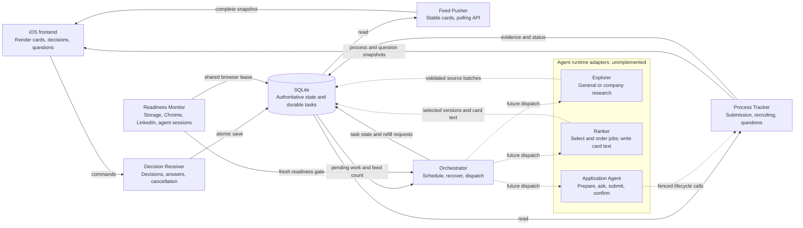

# Job workflow API v1

This contract describes the implemented local backend. SQLite stores decisions,
feed cards, tasks, application processes, question rounds, and receipts. The
agent, LLM, Chrome, and employer integrations are unimplemented. An accepted
Apply decision creates durable work; it does not mean an application was sent.

The iOS implementation belongs in `job-review-ios/`. The existing web app and
legacy iOS transport can keep using the unversioned API in `CONTRACT.md`.
`fixtures/v1-http.json` contains complete, synthetic request and response
examples. Its token, jobs, answers, and IDs are test data.
`fixtures/ranked-flashcard.json` shows a ranked card with generated text and an
order that differs from the source's rank metadata.
`fixtures/health.json` shows synthetic readiness results. Its ready example does
not mean a real Chrome or agent connection has been verified.
`fixtures/auth.json` shows a missing device credential and an authenticated
capability read, using only fictional hostnames and credentials.

## Architecture and control



The orchestrator controls work. SQLite is the source of truth. Reads do not wait
for an agent. These are modules in one Python application, not separate services.
The ranker owns the selection, order, and explanation of its selected jobs. The
iOS frontend owns card rendering, layout, typography, and interactions. It uses
the ranker's text; it does not generate its own reasons for the selection.

The HTTP server calls `Orchestrator.tick()` at most once every five seconds.
A tick recovers expired leases, reconciles processes, and checks the feed buffer.
It does not invoke a runtime. `Orchestrator.run_once()` can dispatch one task
through an injected runtime. The default runtime is disabled and does not claim
queued work. A configured runtime must pass the readiness gate before
`run_once()` can claim a business task. Startup readiness runs separately in a
background thread, so an unavailable agent does not delay HTTP startup.

## Transport and discovery

The server always binds to `127.0.0.1`. It has two explicit modes:

| Requirement | Default local mode | Device access mode (`--access-config PRIVATE_JSON`) |
| --- | --- | --- |
| GET authentication | No bearer credential | One valid `Authorization: Bearer <credential>` header |
| POST authentication | Current `X-Review-Token` | Valid bearer credential and one current `X-Review-Token` |
| Accepted Host | Exact `127.0.0.1:<port>` or `localhost:<port>` | Exact configured HTTPS origin authority, or either local Host for proxy compatibility |
| POST Origin | Exact local HTTP origin | One exact configured HTTPS origin |
| GET Origin | Not required | Not required |
| `capabilities.remote_access` | `false` | `true` |

Device access authentication covers every GET and POST, including health,
capabilities, legacy state, exports, and static files. A loopback peer, local Host,
`Forwarded`, `X-Forwarded-*`, or gateway identity headers do not bypass the bearer
check. The current session token comes from an authenticated successful read. It
is a separate token from the device credential. There are no cookies or redirects.

The iPhone connection must use HTTPS with certificate validation. The implemented
`tls_gateway.py` wrapper runs Caddy with an explicit certificate and a fixed
loopback HTTP upstream. It preserves the public Host, Authorization, Origin,
session token, and command body, and does not retry requests. Never route it to
a server running in default local mode. The gateway rejects a public origin
equal to the backend's local Host aliases; preserving the public Host then makes
an accidental restart in local mode fail with 403.

`remote_access: true` reports server configuration, not TLS deployment,
reachability, worker readiness, or a successful iPhone connection. The capability
is consistent between the capabilities and feed endpoints. Gateway installation,
production credentials and certificates, a reachable network route, and physical
device verification remain deployment work. See [README setup steps](README.md#iphone-access-away-from-home).
The legacy browser UI and `start.py` do not support bearer provisioning; use
`server.py` directly for device access mode.

### Device credentials

`device_access.py create --origin HTTPS_ORIGIN --config PRIVATE_JSON
--credential-output PRIVATE_TEXT` creates one JSON server configuration and one
plain text device credential file on macOS or Linux. The helper normalizes the
origin to a lowercase host, removes a default HTTPS port and trailing slash, and
rejects a path, query, or fragment. Requests must use the resulting exact origin.
The server configuration has `schema_version: 1`, `public_origin`, and `token_sha256`.
The credential is a 43-character URL-safe value generated from 32 random bytes.
The server stores only its SHA-256 hash. Creation uses exclusive, owner-only
files; the helper does not print the bearer value or take it through arguments.
Loading the server configuration requires a regular file owned by the server
user with mode `0600` and no symlink. These files are private deployment inputs,
not source configuration.

Configuration is fixed for the server process. Rotate access by creating a new
pair, restarting with the new configuration, and replacing the iOS Keychain
credential for the same origin. Keep pending command IDs and bodies unchanged.
On 401, refresh the device credential before retrying an authenticated read to
obtain the current session token. Retry a pending command with that session token
and its exact original body. Credential repair must not create a new Apply
intent or clear an uncertain command.

### TLS gateway boundary

The gateway does not change API paths, JSON types, authentication, or retry rules.
Caddy is an external executable; the implementation was validated against the
official 2.11.7 release without a global installation or live deployment.
`tls_gateway.py` accepts `check` or `run` and these options:

| Option | Meaning |
| --- | --- |
| `--access-config` | Required private device access JSON used by the backend |
| `--credential-file` | Required plain text device credential, owned by the current user with mode `0600` |
| `--cert-file` | Required PEM certificate chain for the configured origin's hostname |
| `--key-file` | Required matching, unencrypted PEM private key, owned by the current user with mode `0600` |
| `--caddy` | Caddy executable path; defaults to `caddy` on `PATH` |
| `--backend-port` | Loopback backend port; defaults to 8766 |
| `--listen-address` | IPv4 gateway listener address; defaults to `127.0.0.1` |
| `--listen-port` | Gateway listener port; defaults to the origin's port, or 443 |
| `--ca-file` | Optional extra trusted CA for gateway checks; does not alter iOS trust |

`check` validates local inputs and the Caddy configuration. It also probes the
live backend with the public Host: an unauthenticated call must return 401, and
an authenticated capabilities call must return 200 with `remote_access: true`.
It does not start a TLS listener. `run` performs the same checks, starts Caddy,
and requires an authenticated HTTPS probe with trust and hostname verification
before reporting ready. See the [Caddy CLI reference](https://caddyserver.com/docs/command-line)
for its configuration validation and foreground process commands.

The supplied certificate must be valid, trusted, and match the configured
DNS hostname. Literal IP origins are rejected because TLS clients omit SNI for
them, which conflicts with the strict SNI/Host check. The wrapper does not issue
or renew certificates with ACME. Its Caddy
configuration allows TLS 1.2/1.3 and HTTP/1.1 or HTTP/2. It creates no additional
HTTP redirect, admin, or HTTP/3 listener. [Caddy's TLS reference](https://caddyserver.com/docs/caddyfile/directives/tls)
describes the certificate file and protocol settings.

Only allowed API routes reach `127.0.0.1:<backend-port>`. The gateway has a
1,000,000-byte request body limit and bounded timeouts. Access logs are disabled,
and runtime request details are redacted. Caddy receives no automatic upstream
retry policy, so an uncertain command remains the client's responsibility under
the existing exact-replay rules. Proxy behavior is based on the
[Caddy reverse proxy reference](https://caddyserver.com/docs/caddyfile/directives/reverse_proxy).

Gateway rejections and failures can have plain text bodies instead of the v1
error envelope. For example, an invalid authority receives 421 and a POST without
Content-Length receives 411. Clients must retain pending command IDs and bodies
when they cannot establish an outcome. A proxy response is not permission to
create a replacement Apply request.

The wrapper runs in the foreground and stops on SIGINT or SIGTERM. Generated
configuration passes through standard input. XDG state uses a private temporary
directory removed at stop.
The supplied credentials and certificate files remain operator-owned. A local
HTTPS probe does not establish public DNS, firewall, NAT or CGNAT reachability,
continued host availability, or certificate trust on a physical iPhone. Those
checks remain deployment work. `--ca-file` never disables verification.

Tailscale Serve remains an optional alternative gateway. It can supply private
tailnet HTTPS using its assigned DNS name, with device access controlled by the
tailnet. It is not a backend dependency. See the
[official Serve documentation](https://tailscale.com/docs/features/tailscale-serve).

POST bodies must be JSON objects with `Content-Type: application/json` and one
valid `Content-Length` between 1 and 1,000,000 bytes. Transfer encoding is not
supported. Invalid JSON, including non-JSON numeric constants, is rejected before
the command runs. Responses use `Cache-Control: no-store`.

Call `GET /api/v1/capabilities` to discover v1 support. An older server returns
its legacy 404 response. A v1 server returns this `capabilities` object:

```json
{
  "api_version": 1,
  "worker_enabled": false,
  "worker_status": "not_configured",
  "explicit_apply": true,
  "questions": true,
  "feed_delivery": "poll",
  "question_scopes": ["application"],
  "remote_access": false
}
```

All fields above are required and non-null. The booleans describe this server.
`explicit_apply` means it accepts that command. It does not mean a worker can
execute it. There is no APNs or push notification integration. The client polls.
`worker_enabled` means an enabled runtime is configured, not that its current
checks passed. `worker_status` is the current readiness status below. The feed
and capabilities endpoint use the same runtime status. With the default runtime,
these fields remain `false` and `"not_configured"`.

## Read envelopes and consistency

| GET endpoint | Required data fields |
| --- | --- |
| `/api/v1/capabilities` | `capabilities` object |
| `/api/v1/health` | `health` object |
| `/api/v1/feed` | `cards` array, `counts` object, `refill` object, `capabilities` object |
| `/api/v1/processes` | `processes` array |
| `/api/v1/questions` | `questions` array |
| `/api/v1/tasks` | `tasks` array |

Every successful read also contains these required fields:

| Field | Type and meaning |
| --- | --- |
| `schema_version` | Integer, always `1` |
| `revision` | String; SHA-256 digest of this endpoint's data fields |
| `complete` | Boolean, always `true` |
| `next_cursor` | Always `null` |
| `token` | Nonempty session token string |

Each list is complete. There is no pagination, cursor, incremental update, or
deletion stream in v1. Empty arrays are valid. Clients should ignore unknown
object fields. The token and envelope fields do not contribute to `revision`.
Treat this revision as an opaque content identifier, not an ordered sequence.

Each database-backed read uses one transaction. Separate endpoints do not share
one transaction or a global revision. For example, a process can change between
the process read and the question read. Answer commands check the process,
question, and form versions before saving. Refresh both reads after a conflict.

Keep process and question polling independent of a pending feed decision. A
client can retain its visible card while it resolves an uncertain command.

### Startup health and worker readiness

`GET /api/v1/health` uses the standard read envelope and returns HTTP 200 when
the API can answer. A successful HTTP response does not establish worker
readiness. The client must inspect `health.ready` and `health.status`.

| Health field | Type and meaning |
| --- | --- |
| `boot_id` | Nonempty identifier for this monitor instance; a restart starts a new check |
| `status` | `checking`, `ready`, `blocked`, `not_configured`, `timed_out`, or `stale` |
| `ready` | Boolean; true only while all required checks passed and their result is still fresh |
| `checked_at` | Timestamp of the latest completed or timed-out attempt, or `null` before a result exists |
| `expires_at` | Freshness deadline for a successful result, or `null` |
| `retry_at` | Earliest automatic retry time when applicable, or `null` |
| `checks` | Complete array of the required checks below |

Each check has required string fields `id`, `status`, and `message`. A check's
status is `checking`, `passed`, `failed`, `blocked`, `not_configured`,
`timed_out`, or `stale`. Messages give a short, safe explanation. Clients should
use status values for behavior and display the message to explain the condition.
Public responses omit raw session IDs, posting text, and exception details.

| Check ID | Passing condition |
| --- | --- |
| `storage` | SQLite quick check and a rollback-only write test succeed |
| `chrome_attachment` | The adapter confirms that the Chrome plugin is attached to a usable session |
| `linkedin_auth` | The same Chrome session is currently signed in to LinkedIn |
| `linkedin_job_read` | The same session reads a complete LinkedIn job posting with its exact ID, URL, title, company, and description |
| `explorer_agent` | Its dedicated session answers the current probe and supports `explore` |
| `ranker_agent` | Its dedicated session answers the current probe and supports `rank` and `flashcard_text` |
| `application_agent` | Its dedicated session answers the current probe and supports `apply`, `questions`, and `receipts` |

The server starts checks after binding the HTTP port. The default timeout is 30
seconds and a passing result remains fresh for 300 seconds. Failed checks can
retry after 30 seconds. Expired results become stale and need a new check.
Only one probe can run at a time. A late result after a timeout cannot make the
worker ready. The previous server's ready result is never reused at startup.

Preflight obtains the same durable `browser` resource lock used by application
and exploration work. It is represented by an internal `reconcile` task with
`purpose: "preflight"`. It waits when another worker owns the browser. If a
probe times out, its browser lock stays quarantined until the probe has
positively stopped. A timer alone does not prove that browser access stopped.
The monitor does not launch repeated probes while an earlier call is hung.

Unready workers cannot start a new business task. The API still accepts decisions
and answers, and the scheduler can create refill tasks. An already running
adapter must check session access again before an external action; a previous
ready result is not a guarantee that access will remain available. Preflight does not
discover new jobs, rank jobs, or submit an application. The HTTP server continues
to schedule work without dispatching business tasks; actual runtime execution
remains an integration boundary. There is no separate recheck POST endpoint.

### Feed cards

`cards` is ordered by card creation time, then ID. Each card has these required
fields. Only `content` is nullable:

| Field | Type |
| --- | --- |
| `id` | Opaque string |
| `revision` | Opaque string identifying the saved company and job versions, plus ranked content when present |
| `company` | Company object described below |
| `jobs` | Array of one to three Job objects |
| `content` | Ranked card content described below, or `null` for an existing or curated card |
| `created_at` | Timestamp string |

Polling publishes eligible cards durably. It does not consume them or mark them
viewed. A valid card keeps its ID, revision, job membership, text, and position
when more research or a new ranking arrives. A prepared ranked card waits until
the company's current card is consumed or becomes stale. A changed company
revision or changed selected job revision invalidates the card. A decision
against the old card receives 409. The client must show the new version before
asking for a new decision.

There is at most one ready card per company. A ranked card preserves the ranker's
job order, with its strongest choice first. Source `Job.data.rank` does not
override that order. Existing or curated cards without ranked content use their
supplied numeric rank, then first-seen time and key. Publication does not invent
a match score or generate prose.

#### Ranked card content

The backend saves the ranker's text with the exact selected posting versions.
The `content` object has these required, non-null fields:

| Field | Type and constraint |
| --- | --- |
| `schema_version` | Integer, always `1` |
| `source` | String, always `ranker` |
| `summary` | Nonempty plain-text string, at most 1,000 characters; explains the selected set |
| `jobs` | One to three RankedJob objects, in exactly the same order as the card's `jobs` |

Every RankedJob has these required, non-null fields:

| Field | Type and constraint |
| --- | --- |
| `key` | Exact job key from the card |
| `revision` | Exact positive integer job revision from the card |
| `reason` | Nonempty plain-text string, at most 5,000 characters; explains why this job was selected |
| `brief` | Object with required nonempty plain-text `work`, `fit`, and `gap` strings, each at most 600 characters |

`work` describes the role. `fit` states the evidence for the match. `gap` states
the main gap or unknown. These are display text, not HTML, Markdown, layout, or
style instructions. The frontend chooses how to display them. It must not
replace them with reasons inferred from titles, source rank, or other metadata.
The ranker must keep claims tied to the supplied source and applicant evidence.
It must state gaps and unknowns explicitly and must not invent a fit.

`Job.data` remains the original source metadata, including its title, URL, rank,
and any existing `brief`. Generated text is separate from those facts. The
backend validates the structure, lengths, membership, and versions; it does not
verify the truth of generated prose with an LLM in this version.

Ranked content is frozen with its selected group. If one selected job changes or
becomes ineligible, the whole ranked group becomes stale. The backend does not
attach its old summary to only the surviving jobs. A fresh ranking must provide
new text for a changed group.

Existing and curated cards return `content: null`. Older v1 servers can omit the
field, so clients must treat a missing field as `null`. For these cards, clients
can render existing source text without claiming that the ranker generated it.
Adding `content: null` does not change an existing card's revision. New ranked
card revisions include the saved content.

`counts` contains required integer `ready_cards` and `ready_jobs` fields. The job
count includes jobs on published cards. `refill` contains required integer
`low_watermark` and `target_cards`, plus nullable timestamp `next_allowed_at`.
Defaults are 10 cards, a target of 30 cards, and a 300-second refill cooldown.
The target guides discovery; it is not a hard maximum on cards from imports.

When ready cards are below the watermark, the scheduler creates at most one
active refill task. It first ranks eligible jobs that are not already on cards.
If none remain, it requests exploration. Zero selected jobs can lead to one
bounded exploration pass. Zero source results or zero matches after that pass
are valid. A disabled runtime leaves the work queued; it cannot replenish the
feed by itself.

Eligibility excludes excluded companies, non-pending decisions, reviewed posting
versions, active or applied legacy application work, closed observations, and
current rank rejections. New exploration results require rank selection before
publication. Existing imported research can be published without a new agent
run. Its presence does not prove that a source was checked live.

### Shared Company and Job objects

These objects use the existing legacy shapes. Every listed wrapper field is
required and non-null.

| Company field | Type |
| --- | --- |
| `id`, `name`, `note` | String |
| `data` | Original company metadata object, without its jobs array |
| `excluded` | Boolean |
| `research_status` | `none`, `requested`, `in_progress`, or `done` |
| `revision` | Positive integer |
| `first_seen`, `updated_at` | Timestamp string |

| Job field | Type |
| --- | --- |
| `key`, `company_id`, `job_id`, `note` | String |
| `data` | Original job metadata object |
| `revision` | Positive integer |
| `decision` | `pending`, `later`, `approve`, or `pass` |
| `changed` | Boolean |
| `first_seen`, `updated_at` | Timestamp string |

Treat job keys as opaque identifiers. Job `data` requires string `job_id`,
`title`, and HTTPS `url`. Other source fields are optional JSON metadata. Do not
assume that location, salary, arrangement, rank, brief, or availability is present.
Company `research_status` is legacy state. Read v1 tasks for v1 Find more progress.

## Durable commands

All POST commands return HTTP 200 with a saved acknowledgement. They do not
return a new feed or process snapshot. `accepted: true` confirms a database save.
It does not confirm task completion or employer submission.

Persist the complete command before sending it. Generate a new opaque
`request_id` for a new user intent. Use globally unique IDs across command types.
After a lost response or an uncertain error, resend the same body with the same
ID. Do not add defaults, omit earlier fields, reorder arrays, change notes, or
substitute refreshed revisions. JSON whitespace and object key order do not
affect the stored fingerprint.

The server saves the acknowledgement in the same transaction as the changes.
The original command body is also retained for decision and answer history.
An exact replay returns that acknowledgement after restarts and after later
state changes. The response's session token can change after a restart. A valid
different body that reuses the same ID is a conflict. Decision and cancellation
receipts share one ID namespace; answers have a separate receipt table. Clients
should still use unique IDs across all commands.

### `POST /api/v1/decisions`

| Request field | Required | Type and constraint |
| --- | --- | --- |
| `request_id` | Yes | Nonempty string, at most 200 characters |
| `action` | Yes | `apply`, `find_more`, `exclude`, `pass`, or `later` |
| `card_id` | Yes | Current card ID string, at most 200 characters |
| `card_revision` | Yes | Exact opaque revision from that card |
| `selected` | For `apply`, `pass`, `later` | Array of unique job keys from the card; defaults to `[]` |
| `exclude_job_keys` | No | Array of unique known job keys from this company; defaults to `[]`; only `find_more` accepts nonempty values |
| `note` | No | String, at most 2,500 characters; defaults to `""` |

Key arrays have at most 1,000 entries. Each key has at most 1,000 characters.
`apply`, `pass`, and `later` require at least one selected key. `find_more` and
`exclude` require an empty selection. Optional fields cannot be `null`.

| Action | Atomic effect |
| --- | --- |
| `apply` | Authorize the selected job versions and create one application process and task per selected job |
| `find_more` | Request ranking of remaining eligible jobs at this company, or exploration if none remain; save the supplied exclusions |
| `exclude` | Exclude the company and cancel work that can safely be cancelled; reject if relevant work has started or is blocked |
| `pass` | Save `pass` on selected jobs |
| `later` | Save `later` on selected jobs |

Every action consumes the entire shown card and records every shown posting
version as reviewed. Unselected jobs keep their existing decisions but do not
reappear as the same reviewed version. This is important for a card that contains
several jobs. Later jobs remain saved; there is no automatic later-job reminder
or separate v1 Later list in this API.

Find more exclusions apply to that research request and publication of those
posting revisions. They do not exclude the company. An already-active company
research task makes a new Find more command fail with 409. Exact replay of the
original command still succeeds.

The response contains required `schema_version: 1`, `token`, `request_id`,
`accepted: true`, `decision_id`, `card_id`, `action`, `process_ids`, and `task_ids`.
IDs and action are strings. Both ID lists are arrays and can be empty.
`decision_id` currently equals `request_id`. Use the acknowledgement IDs to
associate later read results with the decision.

### `POST /api/v1/answers`

| Request field | Required | Type and constraint |
| --- | --- | --- |
| `request_id` | Yes | Nonempty string, at most 200 characters |
| `process_id` | Yes | Opaque string, at most 200 characters |
| `process_revision` | Yes | Exact integer from the current process |
| `form_version` | Yes | Exact string from the current process and question round |
| `answers` | Yes | Array of 1 to 50 answer objects |

Each answer requires `question_id` string, `question_revision` integer, and
`value`. Duplicate question IDs are invalid. The answer type must match the
question. `text` uses a string of at most 20,000 characters; required text must
contain non-whitespace text. `single_choice` uses one listed choice ID string.
`multi_choice` uses an array of unique listed choice ID strings. Required
multiple choice questions require at least one selection. An optional text
answer can be `""`; an optional multiple choice answer can be `[]`. Omit an
unanswered optional question. `null` is not an answer value.

All supplied answers are checked before any are saved. Each saved answer
increments its question revision. The command also increments the process
revision. A partial round stays blocked if a required question remains
unanswered. Once all required answers exist, the same task returns to `queued`.
The future worker must revalidate the form before using the answers.

The response has required `schema_version: 1`, `token`, `request_id`,
`accepted: true`, `process_ids`, and `task_ids`. The ID arrays contain the affected
process and its existing task. There is no new application task for the answer.

### `POST /api/v1/tasks/cancel`

The request requires nonempty string `request_id` and `task_id`, each at most
200 characters. It cancels only `queued` or `retry_wait` work. Running, blocked,
finished, or uncertain-submission work cannot be cancelled through this route.
An application cancellation preserves its process history and clears its saved
approval. It does not erase card review history or revive the old card.

The response has required `schema_version: 1`, `token`, `request_id`,
`accepted: true`, `process_ids: []`, and `task_ids: [task_id]`. Cancellation is
idempotent through an exact replay of its original request.

## Process, question, and task fields

### Application processes

`GET /api/v1/processes` returns all v1 processes, newest first by `created_at`,
then ID. It does not turn historical legacy queue entries into v1 processes.
Every field below is required. Only fields marked nullable can be `null`.

| Field | Type and meaning |
| --- | --- |
| `id`, `job_key`, `task_id`, `decision_id` | Opaque strings; process ID also identifies its legacy application queue entry |
| `snapshot` | Immutable object containing approved job metadata plus `company_id`, `company_name`, `job_key`, integer `job_revision`, and string `material_hash` |
| `submission_status` | `not_started`, `preparing`, `submission_unknown`, or `submitted` |
| `recruiting_status` | `awaiting_response`, `responded`, `interviewing`, `offer`, `rejected`, `withdrawn`, or `hired` |
| `task_status` | Task status enum below |
| `revision` | Positive integer |
| `receipt` | Nullable receipt object |
| `block_reason` | Nullable string describing a blocked or cancelled process |
| `form_version` | Nullable string |
| `created_at`, `updated_at` | Timestamp strings |
| `events` | Complete array of process event objects, ordered by integer event ID |

An event contains required integer `id`, string `process_id`, `type`, and
`actor`, object `data`, and timestamp `created_at`. Event types and data are
extensible. Current types include `authorized`, `preparing`,
`questions_requested`, `answers_saved`, `submission_started`, `submitted`,
`recruiting_updated`, `cancelled`, and `blocked`. Actors currently include
`user`, `worker`, `orchestrator`, `operator`, and `tracker`.

A receipt contains required strings `url`, `evidence`, `observed_at`, and
`reference`. `reference` can be empty. The URL must be HTTPS without credentials.
The observed time has a time zone, cannot be in the future, and cannot predate
the associated submission attempt.

Submission, recruiting, and task status are separate dimensions. There is no
`ready` submission state in this version. A process starts as `not_started` and
enters `preparing` when a worker starts. Questions use the task state
`waiting_for_user` and the process `block_reason`; they do not imply submission.
`awaiting_response` is the stored recruiting default. Display it as employer
response progress only after `submission_status == "submitted"`.

Before any action that could submit, the future worker must call
`before_submit()`. This saves a submission attempt and sets
`submission_unknown` before the external side effect. Only a validated receipt
can change that state to `submitted`. A generic task success cannot mark an
application submitted. An automated receipt is not a recruiter response.

If a worker loses its lease, its browser resource stays quarantined. An operator
must first confirm that the old worker stopped. Clearing quarantine does not
restart the task. `resolve_submission(process_id, revision, receipt)` can record
later positive evidence after the worker stops. It cannot infer failure from
missing evidence or authorize another submission. This operator boundary is a
Python method; there is no HTTP reconciliation command yet.

`track_response()` requires a confirmed submission and evidence. It allows
forward recruiting transitions; `rejected`, `withdrawn`, and `hired` are
terminal. There is no HTTP recruiting-update route or inbox watcher yet. Job
removal from a source does not mean rejection.

### Questions

`GET /api/v1/questions` returns all questions in current rounds, including saved
answers, ordered by creation time then ID. Superseded rounds are omitted.
The following fields are required:

| Field | Type |
| --- | --- |
| `id`, `process_id`, `form_version`, `text`, `reason` | String; reason can be empty |
| `revision` | Positive integer |
| `type` | `text`, `single_choice`, or `multi_choice` |
| `choices` | Array of objects with required string `id` and `label` |
| `required` | Boolean |
| `scope` | Always `application` |
| `answer` | Nullable string or array of strings, according to question type |
| `answered_at` | Nullable timestamp string |
| `created_at`, `updated_at` | Timestamp strings |

Text questions have no choices. Choice questions have 1 to 100 choices with
unique IDs. A worker can ask 1 to 50 questions in a round. It must use fresh
question IDs for a replacement round. The question's exact text, required flag,
choices, and form version are saved. Answers have application scope only. The
backend does not promote them to reusable profile facts.

### Public tasks

`GET /api/v1/tasks` returns all tasks, ordered by creation time then ID. Every
field in this table is required:

| Field | Type |
| --- | --- |
| `id` | Opaque string |
| `kind` | `explore`, `rank`, `apply`, or reserved `reconcile` |
| `status` | `queued`, `running`, `waiting_for_user`, `retry_wait`, `succeeded`, `failed`, or `cancelled` |
| `attempts`, `failure_count`, `max_attempts` | Integers |
| `available_at`, `created_at`, `updated_at` | Timestamp strings |
| `resource` | Nullable string; current browser work uses `browser` |
| `resource_quarantined` | Boolean |
| `error` | Nullable diagnostic string |

The HTTP projection excludes payloads, checkpoints, results, lease tokens, lease
owners, and lease deadlines. Those are internal worker data. `attempts` counts
leases, including resume after questions. `failure_count` controls the retry
limit, currently three failures by default. A retryable failure uses a bounded
delay. An uncertain submission never receives an automatic submission retry.

The current dispatcher handles `explore`, `rank`, and `apply`. It does not
schedule or execute the reserved `reconcile` task kind.

## Errors and retry decisions

v1 errors use this envelope. They do not include a token:

```json
{
  "schema_version": 1,
  "error": {
    "code": "conflict",
    "reason": "stale_revision",
    "message": "This card changed or was reviewed. Refresh before making a new decision.",
    "commit_status": "not_committed"
  }
}
```

| HTTP status | `code` | Meaning |
| --- | --- | --- |
| 400 | `invalid_request` | Malformed request or invalid command fields |
| 401 | `unauthorized` | Device credential is missing or invalid in device access mode |
| 403 | `forbidden` | Host, Origin, or session-token check failed |
| 404 | `not_found` | Route or referenced entity does not exist |
| 409 | `conflict` | Stale versions, conflicting state, or reused request ID |
| 500 | `internal_error` | Server could not establish a successful response |

`error.reason` is a required nullable string. Every 409 has one of these stable
values. Other HTTP error statuses return `null`. Use these values, not message
text, to select recovery behavior.

| Conflict reason | Recovery |
| --- | --- |
| `request_id_conflict` | Retain the pending command. Recover the original body; never create a fresh Apply to resolve reused identity. |
| `stale_revision` | This attempt saved nothing. Clear this rejected attempt, refresh the affected card/process/questions, and require a new user decision. |
| `operation_rejected` | This attempt saved nothing because current state prevents the action. Refresh and show the cause before a new intent. |

An unrecognized or missing conflict reason must not trigger a fresh Apply.
Retain the pending command for recovery. Authentication failures also retain it
even though the rejected attempt made no mutation.

Validation and authentication errors have `commit_status: "not_committed"`.
For 401, `reason` is `null`; no current session token or private data is returned.
Unexpected failures after a command starts have `commit_status: "unknown"`.
Keep the pending command and retry it unchanged after an unknown outcome or a
lost connection. For a token failure, obtain a new token and retry the same body.

`not_committed` describes the body rejected by this attempt. It does not prove
that no earlier command with that ID was saved. In particular, a reused-ID
conflict can mean a different original body was already committed. Do not create
a replacement Apply command to resolve that conflict. Recover the original
stored body and inspect current state.

## Legacy compatibility

The unversioned endpoints keep their response shapes and vocabulary. Successful
legacy GET `/api/state` and POST responses still contain complete `ReviewState`
plus a nonempty token. `/api/export` omits the token. Legacy errors stay
`{"error":"message"}`. `/api/apply` remains absent.

Legacy `/api/card` with `approve` saves Ready jobs only. Legacy `/api/queue`
records the separate manual handoff. Neither becomes v1 Apply authorization.
Historical approvals and queue rows are not adopted by the automatic task queue.
Legacy request replay remains supported.

A new v1 application has a legacy queue projection. It uses `queued`,
`in_progress`, `needs_input`, `applied`, `failed`, and `cancelled` as appropriate.
It never writes v1 task states such as `running` into that legacy field. Shared
duplicate checks prevent the same job from being queued through both APIs.
Versioned process status must use the process lifecycle; the legacy status CLI
cannot mark a v1 process applied.

v1 review history uses `wf_reviewed_jobs`. Legacy `card_reviews.action` keeps
its original `approve`, `research`, and `exclude` enum. Both feed implementations
respect reviewed posting versions and application exclusions.

## Files and verification

| File | Responsibility |
| --- | --- |
| `store.py` | Existing catalog, legacy decisions, imports, and SQLite transaction helpers |
| `workflow.py` | Stable cards, v1 decisions, exclusions, discovery/rank result acceptance, refill scheduling |
| `ranking.py` | Validate selected versions, rank order, and generated card text |
| `task_store.py` | Durable tasks, leases, retry limits, checkpoints, shared resource lock, quarantine |
| `application_flow.py` | Authorization snapshots, questions, submission evidence, recruiting transitions |
| `orchestrator.py` | Scheduling, one-task dispatch, runtime protocol, disabled default runtime |
| `readiness.py` | Startup probes, current health report, deadlines, freshness, and worker readiness gate |
| `server.py` | Legacy and v1 HTTP routes, transport checks, public projections, scheduling ticks |
| `device_access.py` | Private device credentials, exact HTTPS origin configuration, and bearer verification |
| `tls_gateway.py` | Caddy TLS configuration, backend authentication checks, verified HTTPS startup, and foreground cleanup |
| `fixtures/v1-http.json` | Synthetic read, command, replay, question, cancellation, and error examples |
| `fixtures/ranked-flashcard.json` | Synthetic rank result and published feed with frozen card text |
| `fixtures/health.json` | Synthetic unconfigured and ready health responses |
| `fixtures/auth.json` | Synthetic device authentication failure and authenticated capability read |
| `test_store.py`, `test_server.py` | Existing store and HTTP behavior |
| `test_workflow.py`, `test_tasks.py`, `test_applications.py`, `test_v1_server.py`, `test_regressions.py`, `test_ranked_cards.py` | Workflow, worker state, application lifecycle, HTTP contract, discovery batches, and ranked card checks |
| `test_preflight_resource.py` | Browser lease, timeout quarantine, and preflight cleanup checks |

From the repository directory, run:

```sh
python3 -B -m unittest discover -s job-review -p 'test_*.py'
```

Tests use temporary databases. HTTP tests bind an ephemeral loopback port. A
sandbox that blocks local socket binding must permit that test operation before
those tests can run. Do not use the real review database for test decisions.

Gateway integration tests need an explicit Caddy executable and `openssl` on
`PATH`. Supply Caddy to run them with the suite; they are skipped when
`JOB_REVIEW_CADDY` or `openssl` is absent:

```sh
JOB_REVIEW_CADDY=/path/to/caddy python3 -B -m unittest discover -s job-review -p 'test_*.py'
```

To run one scheduling pass against a separate database, supply its path:

```sh
python3 -B job-review/orchestrator.py --db /tmp/job-review-demo.sqlite3
```

The command can create or update that database and queue refill work. With the
default runtime it reports `worker_status: "not_configured"` and executes no
agent work. Tests and fixtures validate local behavior with simulated inputs.
They do not verify Chrome, LinkedIn sign-in, LLM ranking, employer submission,
email, remote iPhone access, or notification delivery.

The remaining integration boundary is `AgentRuntime`: implement current-session
preflight checks, source access, ranking and text generation, and the Application
Agent later. Long operations must renew their
lease and stop after a failed renewal. Browser work must respect the shared
resource lock and the application submission checkpoint. The backend does not
implement that agent or browser behavior in this version.

### Runtime preflight boundary

`AgentRuntime.preflight(probe_id, lease)` is intentionally unimplemented. A future
adapter must perform read-only checks through the real Chrome plugin and the
dedicated agent sessions. It returns current evidence in this form:

```json
{
  "probe_id": "current-probe-nonce",
  "chrome": {"attached": true, "session_id": "chrome-session"},
  "linkedin": {"authenticated": true, "session_id": "chrome-session"},
  "posting": {
    "session_id": "chrome-session",
    "url": "https://www.linkedin.com/jobs/view/123/",
    "job_id": "123",
    "title": "Example Backend Engineer",
    "company": "Example Company",
    "description": "Complete posting text read during this probe.",
    "full_description": true
  },
  "agents": {
    "explorer": {
      "session_id": "explorer-session",
      "probe_id": "current-probe-nonce",
      "ready": true,
      "capabilities": ["explore"]
    },
    "ranker": {
      "session_id": "ranker-session",
      "probe_id": "current-probe-nonce",
      "ready": true,
      "capabilities": ["rank", "flashcard_text"]
    },
    "application": {
      "session_id": "application-session",
      "probe_id": "current-probe-nonce",
      "ready": true,
      "capabilities": ["apply", "questions", "receipts"]
    }
  }
}
```

The example is synthetic. Chrome attachment, LinkedIn authentication, and the
posting read must refer to the same session. Each agent needs its own session
and must return the supplied probe ID after a fresh request and response. A
stored session identifier, an existing browser process, or a cached posting does
not satisfy this contract. The posting evidence must come from the authenticated
page, not from a login screen or a public search excerpt. The adapter must obey
its lease and stop after a failed renewal. The backend validates returned
evidence; it cannot prove an adapter performed its promised external checks.
The preflight callback must be synchronous. Its return, including an exception,
means all browser actions started by that callback have stopped. It must not
start detached browser work that continues after the callback returns.

### Ranker result boundary

`AgentRuntime.rank(context, lease)` must return an object with a required `cards`
array. An empty array is a valid result when there are no matches. Each card has
required `company_id`, `summary`, and `jobs` fields. `company_id` is a nonempty
string with at most 200 characters. `summary` and every entry in
`jobs` use the content constraints above. The card result does not include the
feed's `id`, `revision`, `source`, or `schema_version`; the backend supplies them.

The orchestrator loads `discovery_context(task_id, lease_token)` before calling
the ranker. This returns current candidate jobs and company facts and records the
company context sent to that lease. Direct adapter tests must also load it before
submitting a result. Changed company facts or notes invalidate the entire result,
including an empty result. Worker progress checkpoints preserve this binding.

```json
{
  "cards": [
    {
      "company_id": "a",
      "summary": "These roles match the supplied backend experience. Engineer 3 has the strongest match; Kubernetes experience remains unconfirmed.",
      "jobs": [
        {
          "key": "a:3",
          "revision": 1,
          "reason": "The supplied evidence best supports this role's backend reliability work.",
          "brief": {
            "work": "Build and maintain backend services.",
            "fit": "The supplied profile describes backend reliability work.",
            "gap": "Kubernetes experience is unconfirmed."
          }
        },
        {
          "key": "a:1",
          "revision": 1,
          "reason": "The backend work is relevant, but the platform requirements need further verification.",
          "brief": {
            "work": "Develop backend platform services.",
            "fit": "The supplied profile includes backend engineering.",
            "gap": "Platform-specific experience needs verification."
          }
        }
      ]
    }
  ]
}
```

The example is fictional. A result can contain at most 50 cards with unique
companies and one to three jobs per card. Each selected job must belong to that
company and match an eligible candidate's exact key and revision. Job keys must
be unique. The order of `jobs` is the ranker's order of preference. A result with
missing text, invalid membership, or stale versions is rejected as a whole;
partial ranked cards are not published. This interface replaces the earlier
selection-only result. No agent or LLM implementation is included.

Explorer results are bounded to 50 companies and 200 jobs per batch. Preserve
source evidence in posting metadata. `verified_at` is optional and must be a
past timestamp with a time zone when supplied. An import does not invent a
source verification time. Ranking distinguishes pending work from a completed
rejection, so later batches remain eligible and unchanged rejections do not
repeat after an empty exploration result.
