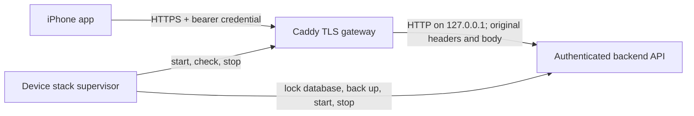
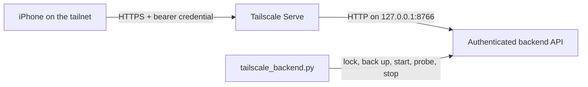

# Continuous job review

Current ownership, deployment state, and remaining work: [Backend status](BACKEND_STATUS.md).

Review one company at a time. Stop when you want. Each card decision saves before the next card opens. The local queue records approved jobs and research requests. The legacy web UI records manual work. The v1 backend can execute explicitly approved work only when its Codex runtime is configured.

## Backend workflow v1

The backend has durable task scheduling, explicit Apply decisions, feed refill,
application tracking, and structured questions and answers. `CodexRuntime` and
`CodexTransport` implement the Explorer, Ranker, and Application Agent adapters.
Execution requires an explicit `--runtime-config` path. Without it, the worker
reports `not_configured` and leaves tasks queued. Implemented adapters do not
establish that a production runtime is enabled or that a live pipeline has passed.

The [v1 contract](CONTRACT_V1.md) defines the iOS endpoints, data types, retry rules,
architecture, and worker boundary. [HTTP fixtures](fixtures/v1-http.json) contain
fictional request and response examples. A [ranked card fixture](fixtures/ranked-flashcard.json)
shows the ranker's text and job order. [Health fixtures](fixtures/health.json)
show disabled, idle, ready, and blocked browser health responses. [Device access fixtures](fixtures/auth.json)
show an authentication failure and a successful capability read. The iOS app is developed separately in
`job-review-ios/`; these backend changes do not switch its transport automatically.

Blocked tasks can receive user guidance through the capability-gated
[unblock instruction API](UNBLOCK_INSTRUCTIONS_CONTRACT.md). Clients keep the
exact task and process revisions, saved history, and retry receipt. Eligible
stopped applications can retry preparation with the guidance under their existing
approval and retry budget. Other eligible blockers schedule a read-only check.
Missing required answers, uncertain submissions and quarantined work retain their
gates. Instruction text cannot supply legal consent or bypass a tool permission.

The ranker selects and orders up to three jobs per company. It also writes the
card summary and each job's selection reason, work, fit, and gap. The backend
stores this text with the exact selected job versions. The iOS app owns rendering,
layout, typography, and interactions. It displays the supplied text and does not
generate its own explanation for the ranker's choices.

Generated text is separate from the original posting data. A published card
keeps its text and order when new rankings arrive. If a selected posting changes,
the whole ranked group becomes stale; its old summary is not reused for a
smaller group. Existing or curated cards have `content: null` and keep their
source text. `CodexRuntime.rank(context, lease)` reads stored candidates and
confirmed applicant evidence without Chrome. After validation, SQLite records
the accepted result and a durable export request. The backend writes a private
`ranked-output/<task-id>.json` file beside the database before it publishes the
new cards. A failed file write retries export without repeating the model call.

The existing web UI and unversioned endpoints retain their manual behavior.
Approve saves a choice. Queue records a manual handoff. Neither action creates an
automatic Apply task. Only `/api/v1/decisions` with `action: "apply"` creates a
versioned application process. The process captures the exact approved posting.

The server schedules a refill check every five seconds. It requests work when
fewer than 10 company cards remain, with a target of 30 cards and a five-minute
cooldown. One active refill is allowed. New agent results need ranking before
publication. Feed delivery uses polling; APNs is not included.

The physical iPhone connection uses HTTPS and authenticated device access. The
backend binds only to loopback HTTP. `tailscale_backend.py` supports private
Tailscale Serve access; `device_stack.py` retains the Caddy gateway option.
Keep deployment and device verification records separate from adapter tests.

At startup, the server checks local storage in a background thread. It does not
open Chrome or start an agent health probe. An enabled runtime reports `idle`,
with browser checks `on_demand`, until a browser task needs access. Rank work
requires healthy storage and runs without Chrome.

Before each Explore or Apply task, the worker acquires the durable `browser`
resource and calls `prepare_browser(task, lease)`. The runtime reuses an open
LinkedIn tab or opens one in the existing Chrome profile. It confirms current
sign-in from the page and hands the exact tab to the task. The health module
distinguishes stopped, recoverable tab/session/attachment errors from sign-in,
CAPTCHA and permission failures. Recoverable errors use durable backoff and check
readiness again under the next task lease. No login is automated.

The Mac dashboard presents a one-time **Agree** dialog for project browser and
resume access. The backend stores that grant in `wf_project_consent`, with its
fixed policy version, scopes, source and timestamp. It persists across app and
service restarts. Until it exists, Explore and Apply tasks stay queued without
acquiring a browser lease or spending attempts. Rank and local work can continue.
The next worker poll resumes eligible queued browser work after agreement.

The grant permits reading LinkedIn, company websites and official employer ATS
job/application pages through the existing Chrome profile. It also permits upload
of the configured approved resume for explicitly approved jobs. Each browser turn
receives this recorded consent from the host. It must not ask for the same project
consent again. Exact-job approval, final submission checks, employer legal
acknowledgments, sign-in/CAPTCHA, and Chrome/OS/tool permission controls remain
separate. An external permission denial is still a blocker; this app cannot grant
or bypass that permission.

For an existing installation whose user has already explicitly granted this scope,
an operator can record that instruction without another dialog. First let the
backend supervisor complete its normal backed-up schema migration. Then run:

```sh
python3 job-review/project_consent.py --db /absolute/path/review.sqlite3 \
  --request-id stable-consent-import-id --source-reference chat-id-and-message-date
```

This helper requires the existing migrated database. It writes only a consent
record and its idempotent command receipt, with `source: "user_chat"`. It does not
start workers, edit the applicant profile, resume blocked tasks, or contact an
employer. The source reference must contain no credentials or private answer text.
Record a grant only when that referenced user instruction explicitly covers the
policy. The authenticated API is described in [the v1 contract](CONTRACT_V1.md).

The HTTP API stays available while agents work. `worker_runner.py` has separate
discovery (`explore`, `rank`) and application threads. The new application pool
uses three durable workers with separate native sessions and browser leases.
A paused application retains its worker while the other workers continue.
Discovery's global browser lease waits for active application browser leases;
Rank can proceed while applications use Chrome. The legacy single-worker mode
remains available. The [pool contract](APPLY_POOL_CONTRACT.md) defines activation,
the live workflow endpoint, cross-device question state, and the Chrome handoff
verification gate. The [cutover plan](APPLY_POOL_SMOKE_PLAN.md) defines the
authorized rollout; source implementation does not establish deployment.
Every browser task checks access again. A five-minute health observation is not
permission to skip that check. Unknown browser completion keeps the resource
quarantined until an operator confirms that the old work stopped.

To check scheduling against a disposable database:

```sh
python3 job-review/orchestrator.py --db /private/tmp/job-review-workflow-demo.sqlite3
```

This creates a queued refill and reports that the worker is not configured. It
does not crawl sources or send applications. Starting a new server loads v1;
an already running server must be restarted separately. Development tests do not
restart or migrate the live server.

Run the backend tests from the workspace root:

```sh
python3 -B -m unittest discover -s job-review -p 'test_*.py'
```

All test databases are temporary. HTTP tests require permission to bind an
ephemeral loopback port. The legacy JSON export remains unchanged; retain the
SQLite database to preserve the full v1 task, question, and process history.

Start the local app from the workspace root:

```sh
python3 job-review/start.py
```

Open <http://127.0.0.1:8766>. The database is `job-review/state/review.sqlite3`. Keep the complete `state/` directory when moving the app. Stop the server before copying a database backup, or use SQLite's backup API. A JSON export is available in the app and at `/api/export`; it contains choices and history, but no session token.

## iPhone access away from home

Production uses the authenticated backend behind private Tailscale HTTPS. The
production domain and device credential are provisioned, and physical iPhone
Wi-Fi/LTE access is verified. See `workflow.json` and `RUNTIME_VERIFICATION.md`
for dated evidence. `device_stack.py` retains the alternative Caddy TLS gateway
and foreground supervisor. `start.py` and the legacy browser UI remain local-only.



Caddy 2.11.7 is installed in the project at
[.tools/caddy/2.11.7/caddy](.tools/caddy/2.11.7/caddy). Its archive digest was
checked against the official release. The local
[verification receipt](.tools/caddy/2.11.7/verified-install.json) records the
source and digests. This is a macOS ARM64 binary, not a global installation.

The remaining deployment inputs are the confirmed HTTPS origin, a reachable
network route, a trusted PEM certificate chain, and its matching unencrypted
PEM private key. The key must be a regular file owned by the current user with
mode `0600`, not a symlink. Certificate issuance and renewal are not automated.
Caddy supports supplied certificate and key files; see its
[TLS reference](https://caddyserver.com/docs/caddyfile/directives/tls).

The origin must use a DNS hostname; literal IP origins cannot pass the gateway's
strict TLS SNI/Host check. DNS, firewall rules, NAT or CGNAT access, and keeping
the backend host awake are separate deployment work. A successful local HTTPS
probe does not prove reachability from an iPhone away from home.

### Private stack configuration

[device-stack.example.json](device-stack.example.json) is a configuration
template for the private file `job-review/state/device/stack.json`. It contains
no secrets and is not a deployment configuration. The private file must be
owned by the current user, have mode `0600`, and must not be a symlink. The schema
contains exactly `schema_version: 1`, `database`, and `gateway`; unknown fields
are rejected.

Relative paths use the private configuration file's directory, not the current
working directory. At `state/device/stack.json`, the template resolves these
paths:

| Configuration value | Resolved project path |
| --- | --- |
| `database: "../review.sqlite3"` | Existing `state/review.sqlite3` |
| `gateway.access_config: "access.json"` | `state/device/access.json` |
| `gateway.credential_file: "credential.txt"` | `state/device/credential.txt` |
| `gateway.cert_file: "fullchain.pem"` | `state/device/fullchain.pem` |
| `gateway.key_file: "private-key.pem"` | `state/device/private-key.pem` |
| `gateway.caddy: "../../.tools/caddy/2.11.7/caddy"` | `.tools/caddy/2.11.7/caddy` |

Absolute file paths also work. The template keeps the existing review database;
it does not create a replacement catalog or reset decisions. Its listener is
`127.0.0.1:8443`, which is for local verification. Deployment selects the intended
reachable interface and port. `gateway.backend_port` defaults to 8766,
`listen_address` to `127.0.0.1`, and `listen_port` to the public origin's port or
443. `caddy` defaults to a command on `PATH`. Optional `ca_file` adds a trusted CA
for checks without changing iPhone trust or disabling certificate verification.

Device credentials are generated with `device_access.py`. This command is an
operator reference, not a completed deployment. `jobs.example.com:8443` is a
placeholder for the confirmed origin; both output directories must already
exist:

```sh
python3 job-review/device_access.py create \
  --origin https://jobs.example.com:8443 \
  --config job-review/state/device/access.json \
  --credential-output job-review/state/device/credential.txt
```

The helper creates owner-only files and refuses existing destinations. The
access JSON contains only the credential hash. The separate text file contains
the bearer secret. The helper does not print the secret or accept it as a
command-line argument. The iOS app stores its credential in Keychain. Private
configuration, certificates, and credentials remain outside the example file.

### Check and run the complete stack

The check and run commands use the same private configuration:

```sh
python3 job-review/device_stack.py check --config job-review/state/device/stack.json
python3 job-review/device_stack.py run --config job-review/state/device/stack.json
```

`check` validates the private configuration, device credential, certificate
trust and hostname, matching key, and Caddy configuration. It opens no database
or network listener and does not require a running backend. Configuration
validation uses Caddy's [documented CLI](https://caddyserver.com/docs/command-line).

`run` validates the same inputs, locks the selected database for this stack,
and refuses an occupied backend port. Before starting the backend on an existing
database, it makes an online SQLite backup, including committed WAL contents,
and checks the backup with `PRAGMA quick_check`. Backups are retained in a
`backups/` directory beside the database with mode `0700`; each backup file has
mode `0600`. A failed backup stops startup. The existing database and saved
decisions remain in place.

The supervisor starts the authenticated backend and the real Caddy process. It
checks that an unauthenticated backend request gets 401 and an authenticated
request reports `remote_access: true`. It then verifies an authenticated request
through TLS, including certificate trust and hostname, before reporting
`API and TLS ready`. Worker state is reported separately. This Caddy supervisor does not load a
Codex runtime, so `not_configured` is expected even with a ready API.

A separate terminal can inspect the running stack without starting another:

```sh
python3 job-review/device_stack.py status --config job-review/state/device/stack.json
```

`status` verifies authenticated local HTTPS and reads the worker health report.
It does not establish Internet or physical iPhone reachability.

The stack stays in the foreground. Ctrl+C, SIGTERM, or a backend or gateway
failure stops both components. It removes temporary Caddy state and retains the
database and verified backups. A second stack for the same database cannot
start while the lock is held. This lock coordinates stack processes; it does not
manage an existing server started by `start.py`. An occupied port is an error,
not permission to replace a process. Do not stop a process using an unchecked
PID from a file.

The gateway serves API routes only. It uses TLS 1.2/1.3 and HTTP/1.1 or HTTP/2,
with no HTTP redirect, admin, or HTTP/3 listener. It limits request sizes and
timeouts, disables access logs, redacts request details from runtime logs, and
does not retry upstream requests. It preserves the public Host, bearer
credential, Origin, session token, and command body. See the
[Caddy reverse proxy reference](https://caddyserver.com/docs/caddyfile/directives/reverse_proxy).

Do not proxy the default local mode. The configured public origin must differ
from the backend's local Host aliases. The preserved public Host makes an
accidental restart in local mode fail closed with 403. `remote_access: true`
reports authentication configuration, not gateway reachability or worker
readiness. Connectivity checks must not create a test Apply decision in the real
database. Tests use temporary databases.

To rotate access, provision a new access configuration and credential pair,
restart the stack with them, and update the iOS Keychain credential for the same
origin. Keep pending commands, including their request IDs and exact bodies.
After authentication succeeds, obtain a current session token and retry the
original command unchanged. A 401 does not justify a new Apply request.

The individual `server.py` and `tls_gateway.py check|run` commands remain
available for development and diagnostics; their options are in the
[v1 contract](CONTRACT_V1.md#tls-gateway-boundary). Unlike `device_stack.py check`,
`tls_gateway.py check` requires a running authenticated backend. The stack
command is the combined lifecycle entry point.

Tailscale Serve is an optional alternative gateway. It supplies private tailnet
HTTPS using its assigned DNS name and requires Tailscale access on both devices.
It is not a backend dependency. Existing Serve configuration must be inspected
before changing a service, and its upstream must be the authenticated backend.
Public Funnel is outside this setup. See the
[Serve documentation](https://tailscale.com/docs/features/tailscale-serve) and
[CLI reference](https://tailscale.com/docs/reference/tailscale-cli/serve).

Run the full suite with the installed project binary to include real Caddy
integration tests. They also need `openssl` on `PATH` and are skipped if either
it or `JOB_REVIEW_CADDY` is absent. The HTTP/2 case requires a `curl` build with
HTTP/2 support:

```sh
JOB_REVIEW_CADDY="$PWD/job-review/.tools/caddy/2.11.7/caddy" python3 -B -m unittest discover -s job-review -p 'test_*.py'
```

## Tailscale Serve alternative

`tailscale_backend.py` supervises only the authenticated backend when Tailscale
Serve supplies HTTPS. The existing `device_stack.py` and Caddy route remain
available. Use one supervisor for a database at a time.



Configure Serve separately to forward the selected HTTPS origin to
`http://127.0.0.1:8766`. Set the same origin in the private device access file
and the iOS app. Tailscale identity headers do not replace the bearer credential.
The backend also checks the exact HTTPS `Origin` and session token on writes.
No secrets belong in the app bundle, URL, command arguments, or logs.

The commands below use private credential files provisioned separately with
`device_access.py`. Both files must be regular files owned by the current user
with mode `0600`; symbolic links are rejected. Commands take file paths, never
the credential text. Run them from the workspace root:

```sh
python3 job-review/tailscale_backend.py check \
  --db job-review/state/review.sqlite3 \
  --access-config job-review/state/device/tailscale-access.json \
  --credential-file job-review/state/device/tailscale-credential.txt \
  --port 8766

python3 job-review/tailscale_backend.py run \
  --db job-review/state/review.sqlite3 \
  --access-config job-review/state/device/tailscale-access.json \
  --credential-file job-review/state/device/tailscale-credential.txt \
  --port 8766

python3 job-review/tailscale_backend.py status \
  --db job-review/state/review.sqlite3 \
  --access-config job-review/state/device/tailscale-access.json \
  --credential-file job-review/state/device/tailscale-credential.txt \
  --port 8766
```

`check` validates authentication inputs without opening the database or a
listener. `run` takes the same database lock as `device_stack.py`, refuses an
occupied port before opening the database, and creates a verified SQLite backup
before migrations. The backup includes committed WAL data and remains after
shutdown. An absent database is created only when startup can proceed.

The server binds only to `127.0.0.1`. Startup verifies unauthenticated HTTP 401
and authenticated HTTP 200 responses. Workers stay disabled unless the command
includes an explicit `--runtime-config` path. Up to 16 request connections may run at once;
excess connections close, and socket reads have a ten-second idle timeout. The
API's existing request body limit still applies. Shutdown closes open request
sockets, cancels agent calls, and waits for accepted requests and worker threads
before releasing the database lock. An interrupted browser call can still leave
a quarantined task; process termination alone does not prove the browser stopped.

Every start with `--runtime-config` resumes eligible work from the existing
SQLite queue. No separate resume command is needed. Task IDs, exact-job approvals,
answers and checkpoints survive the restart. The worker lanes recover local state
before claiming work, then repeat this check while the server runs.

| Saved state | Behavior after restart |
| --- | --- |
| Queued work | Run automatically when its worker and resource are available. |
| Retry wait | Run at the saved retry time, within the existing failure limit. |
| Local agent call stopped during shutdown | Queue the same task without consuming its failure limit, once the local process has stopped. |
| Expired local ranking lease after a crash | Fence the old worker, then retry after the recovery cooldown. |
| Waiting for answers | Review current saved answers and profile evidence automatically. Keep questions that still need a fact or specific consent. |
| Waiting for a browser prerequisite | Stay parked. No scheduled browser or model checks. An explicit user action can request a bounded preparation retry when the existing gates allow it. |
| Waiting for project consent or posting review | Keep the saved wait. A restart does not grant consent or approve changed work. |
| Interrupted browser work | Keep the browser resource quarantined until the old work is confirmed stopped. |
| Submission started without a confirmed receipt | Keep `submission_unknown`; reconcile the result before any new submission. |
| Succeeded, cancelled or failed | Keep the terminal result; do not replay it on startup. |

Restart tests in `test_server_recovery.py` boot the actual backend repeatedly with
temporary databases and fictional workers. They check saved answers, retry times,
task identity, old-worker fencing, quarantine and duplicate-submission prevention.

A completed Codex turn that explicitly reports `Selected model is at capacity.`
before any tool or external action starts gets three durable retries, after 30,
60 and 120 seconds. This provider retry budget is separate from application
failures and cannot be cleared by a worker checkpoint. Each retry keeps the same
task and browser session and repeats the task's readiness check. The health report
shows `retry_wait`; it does not report a Chrome failure. Mixed errors, incomplete
event streams, tool activity, quarantine and started submissions do not qualify.
Exhausted capacity retries leave the task failed. The backend does not change the
configured model or provider.

Automatic browser-blocker monitoring was removed on October 20, 2026. Parked
applications do not schedule model observations or periodic native-session probes.
An explicit eligible instruction can request a preparation retry; normal readiness,
approval, question and submission gates still apply. Login/challenge instructions
are saved for manual follow-up. A failed check returns the task to its parked state.
Existing `wf_browser_waits` rows remain inert historical data. Fresh databases do
not create that table. Current code neither reads nor updates it.

`status` reads the local authenticated API. It does not prove that Tailscale
HTTPS, certificate validation, or an iPhone connection works. Verify those
separately against the actual HTTPS origin. The supervisor does not install,
start, stop, or change Tailscale. Serve configuration can outlive this foreground
process; stop or update Serve separately when changing its target.

Focused tests use fictional temporary databases and loopback sockets:

```sh
python3 -B -m unittest discover -s job-review -p 'test_tailscale_backend.py' -v
```

## Configure Codex execution

`server.py` and `tailscale_backend.py run` accept `--runtime-config PRIVATE_JSON`.
The file selects the executable, private run directory, source documents, and
enabled task kinds. Omit this option to keep execution disabled. `start.py` and
`device_stack.py` retain their existing behavior and do not load this runtime.

Example configuration with placeholder document and executable paths:

```json
{
  "schema_version": 1,
  "codex_binary": "/absolute/path/to/codex",
  "run_directory": "../agent-runs",
  "evidence_files": ["/absolute/path/to/confirmed-resume.md"],
  "supported_kinds": ["explore", "rank"],
  "timeout_seconds": 900
}
```

Paths resolve relative to the configuration file; absolute paths remain absolute.
The Codex executable must exist and be executable. Evidence files must exist.
The run directory must be private (`0700`). Worker input, output, schema, and
receipt files use `0600`. Keep this configuration private because it identifies
personal documents. Device bearer credentials do not belong in runtime config.

`explore` and `rank` require at least one confirmed applicant evidence file. To
enable `apply`, add it to `supported_kinds` and supply existing
`application_profile`, `resume`, and `application_index` paths, plus readable
resume text in `evidence_files`. The resume must
be the approved document. The default kind list, when omitted, contains all
three kinds, so an explicit list is preferable during staged checks. Unknown
configuration keys are rejected. `timeout_seconds` defaults to 900.

`browser_transport` selects `exec` (the default) or `app-server`. The latter uses
the supported bidirectional Codex protocol for browser turns, while rank and
answer review keep the existing CLI transport. It inherits the configured model,
effort and approval reviewer. Browser turns keep the read-only shell sandbox.
The host can answer the exact installed Chrome upload consent form during
application preparation. It requires standing project consent, a current task
lease, the approved job's HTTPS origin and an unchanged verified resume. Chrome's
grant is origin-scoped; the host records a session-only grant and the resume hash
in the private receipt. It does not claim that Chrome enforces a file-scoped grant.
Other origins, strict automatic-review requests, authentication, device verification,
unknown forms, and shell permissions are not accepted by this handler. The handler
does not modify extension permissions or permission storage.

For an explicit document choice on one application, the private host configuration
can set `application_resumes` with the exact process ID as its key. Each entry
contains `path`, `sha256`, `bytes`, `uploaded_filename`, and `source_reference`.
The host checks the pinned file before preparation and again at the submission
checkpoint. A missing or changed file stops that application; it does not fall
back to the global resume. Other applications keep their configured default.
Agent checkpoints cannot select a different document. The recorded filename is
an observation to compare with the current form, not proof that an attachment
still exists or permission to bypass an upload approval.

To load the runtime through the Tailscale supervisor, add this option to its
existing `run` command:

```sh
--runtime-config job-review/state/device/runtime.json
```

Use the already selected database, origin, and credential files. Do not start a
second supervisor for the same database. Loading this configuration makes
matching queued tasks eligible for execution; use a disposable database for
fixture tests and choose task kinds deliberately for live verification.

With `browser_transport: "app-server"` and `browser_session_policy: "shared"`,
new browser work uses one named Codex conversation across tasks. Readiness,
exploration, preparation and submission resume its exact private host binding.
After ten distinct confirmed applications, new work uses the next conversation.
Attempts, retries and uncertain submissions do not count. Pending applications
stay on their original conversation until complete. A retired conversation is
archived only after its drafts have finished and native history matches its
completed host receipt. Existing per-task draft sessions drain in place. The
default `per_task` policy remains available for older configurations.

Chrome clears prior handoff marks on each resumed turn. Every shared browser
turn, including readiness and exploration, must reapply `markHandoff()` to all
unfinished application drafts already owned by that conversation. The host gives
the worker the current pending job identities. It must not claim another
conversation's tabs or act on another job. Fresh task context and stored approvals
remain authoritative. A global private file lock excludes simultaneous shared
calls; an uncertain receipt blocks further shared work after a crash. Workers
cannot spawn helper agents or create more chats. Native model and effort settings
stay unchanged. An explorer reacquires LinkedIn if its temporary tab was cleaned up.
Local ranking and evidence review use separate ephemeral agents. The transport uses the read-only filesystem sandbox,
passes task input on stdin, validates structured output, and renews task leases.
Browser roles use the existing Chrome profile through the Chrome plugin. They
do not use a new profile, CDP, cookie extraction, or direct LinkedIn HTTP APIs.
Rank receives stored postings and local evidence and is instructed not to use
browser or network tools. Agent output is untrusted until host validation.

Tab IDs from other sessions are hints. A worker tries supported lookup, then can
open a task-owned tab at the exact approved URL in the same Chrome profile when
the old tab is explicitly unavailable. It rechecks the draft and attachment.
It cannot use this recovery for a denied permission or an uncertain submission.
An unfinished browser-turn receipt stops replay even after server restart.

During preparation, a temporary site error that explicitly requests a refresh
allows one reload of the same owned draft. All prior actions must have completed
with known outcomes, and no submission may have started. The worker rechecks the
job, draft and attachment afterward. A persistent error uses the existing bounded
retry schedule and releases the browser for other work. After those retries,
the task waits for a read-only health check. Fresh evidence that the exact blocker
cleared permits one further execution; earlier failure history remains recorded.
This recovery does not
apply to permission denials, login, CAPTCHA, validation errors or uncertain actions.

The production browser transport uses the native app-server approval channel.
The host can accept a supported resume-upload request when stored project consent,
the exact job approval, current lease, destination origin, preparation stage and
resume hash all match. The grant lasts for that worker session. Login, CAPTCHA,
device verification and unrelated permission requests still require their own
resolution. The optional `codex exec` transport cannot receive interactive upload
approval. In either transport, the worker must verify the actual attachment and
exact requisition before it continues.

Application preparation and submission use separate agent calls. Each preparation
loads current profile, resume text and application history into a bounded source
snapshot with line numbers and SHA-256 hashes. Proposed questions receive a
separate browser-free evidence review before they reach the user. The backend
validates exact citations, source freshness, question revisions and observed
choice IDs. It can reuse confirmed facts and draft professional motivation from
the approved role and resume. Unknown facts and specific legal consent stay pending.

Automatic answers use an internal writer and `wf_answer_evidence` provenance.
They never overwrite an existing answer or claim to be user input. All saved
answers retain their IDs and values across later question rounds. Changed source
snapshots trigger a browser-free check of existing automatic answers before form
actions. Still-supported values retain their exact wording and receive fresh
provenance. Conflicting answers stop for review. Actual user replacements remain
authoritative.

Parked questions are also reviewed automatically in a separate browser-free lane
when the complete profile/resume/history evidence or question round changes.
`wf_question_reviews` stores durable review keys, bounded retries and outcomes.
Unchanged completed reviews survive restart. Only still-missing facts or specific
consent remain questions. A crash between saving partial answers and recording
the review receipt can cause one extra review, but cannot overwrite those answers.
The lane is disabled when workers are disabled and must stop before the backend
releases its database lock.

Each accepted user answer immediately wakes this lane. If a review is active,
the backend coalesces answer changes into one follow-up scan of all parked
questions. A concurrent answer invalidates stale results. Polling remains a
restart and file-edit fallback, and durable retry limits still apply.

Preparation retains observed questions even when a separate human browser
blocker remains. Saved-answer reuse can resolve those questions while parked.
Answers cannot clear the browser blocker or grant a denied operation.

The scheduler also repairs a stale question wait when the current question round
is complete in the database. It requires current approval, remaining retry budget,
no browser lock and no submission attempt. An empty question list, partial answers
or a different blocker cannot clear the wait.

Lost browser leases remain quarantined until explicit operator reconciliation.
The service no longer polls native sessions to recover interrupted readiness.

An unspecified office cadence can receive a narrow compatibility review against
an explicit saved work preference. The work mode and every other material field
must remain unchanged. Source-validated proof is stored in the task checkpoint;
the original approval snapshot is retained. A pay, location, title, level, work
mode or other material change still needs review.
An invalid local compatibility result receives one correction attempt with the
same source snapshot. Full-line citations remain mandatory. Repeated invalid
output stops with a technical review failure; it does not ask for an already
saved preference or replay browser actions.

Every accepted user answer also creates a durable `wf_profile_answers` record and
`wf_profile_outbox` entry in the same transaction. The backend projects current
answers into the configured `application_profile` Markdown file, preserving its
manual content. Records include exact question text, answer labels, source request,
revision, date, company and application context. SQLite retains correction history.
Worker-generated answers never become user-confirmed profile facts.

The projection uses a private atomic file replacement and retries failed writes.
An already accepted answer still returns its original receipt if the file write
fails. Workers wait for pending profile updates before using the evidence. The
write transaction checks for pending newer answers before automatic answer saves
or submission. Source changes during preparation requeue the task without spending
its failure budget.

Exact reusable questions resolve from saved profile records before a model call.
Choice labels map to the current form's IDs. Portable facts can cross employers;
employer history and specific consent keep their context. New user answers can
also resolve identical questions in other pending applications during scheduling,
without a browser or model call. Equivalent wording uses the evidence review.

Unanswered questions are saved with revisions and the browser is released while
the user answers. Before submission, the backend rechecks the approved posting and form,
then commits `before_submit`. It records success only from a matching observed
receipt. An unknown result requires reconciliation and cannot auto-submit again.

To review existing parked question rounds, use the bounded operator command below.
It reads an existing database without migrations and saves a new private plan.
Inspect that plan before applying it. Applying uses the same revision, approval,
source and submission guards as the runtime; complete answers queue the same task.
It does not resolve unrelated sign-in, upload or posting-change blockers.

```sh
python3 job-review/reconcile_questions.py review --db DATABASE --runtime-config PRIVATE_CONFIG --plan NEW_PRIVATE_PLAN
python3 job-review/reconcile_questions.py apply --db DATABASE --runtime-config PRIVATE_CONFIG --plan NEW_PRIVATE_PLAN
```

Unit and fixture tests do not establish production activation or live Chrome,
LinkedIn, ranking, or employer submission success. Record live checks separately.

## Review a company

The main **Review** view shows one centered company card and up to three jobs. Each job shows its exact title, work setting, work, fit, and main gap. Open its details for pay and full source evidence. **Browse** opens the search, saved jobs, queue, and other views.

Drag or swipe the card left to exclude the company. Swipe right to approve only the checked jobs. The three labeled buttons provide the same actions, including **Find more**. A right swipe with no checked jobs cannot approve anything. Vertical scrolling, short drags, and gestures that start on a link or control do not save a decision.

- Pick exact jobs, then choose **Approve selected jobs**. Only those jobs move to Ready.
- Choose **Find more jobs** to request research for that company. Earlier job choices stay saved.
- Choose **Exclude company** to hide the company and cancel its queued work. Resolve started work first.

Nothing is selected for you. Picking a checkbox alone does not save an approval. A successful card action records all jobs shown as reviewed. Unselected jobs remain available in **All jobs** and **Inbox**. They are not rejected or approved. Use those views to change an earlier choice or add a note.

Review progress stays in the database across refreshes and server restarts. **Review last decision** opens that company's saved jobs. There is no requirement to review all companies in one session. New jobs can arrive while older jobs remain waiting.

## If a save fails

The app stays on the card until the server confirms the save. A stale card cannot save over newer data. Load its current details, check them, and make the choice again.

If the connection stops, a request may already have saved. Reconnect and select **Refresh feed**, then **Check card decision** or **Check queue request**. The app retries the same request ID and exact selection. The server returns the saved result without adding duplicate work. Do not create a different request to recover an uncertain save. The app keeps an unresolved request in browser storage across a reload.

Saved choices remain on the server when the app is offline. Save or discard any unsaved notes before making another decision.

## Add more research

Create a JSON file with a `companies` list. Each company needs its stable `id`, `name`, and a nonempty `jobs` list. Each job needs its exact `job_id`, exact `title`, and official HTTPS `url`. Preserve full source evidence in the posting data. Add `brief: {work, fit, gap}` for the short descriptions.

```sh
python3 job-review/import_catalog.py path/to/new-research.json
```

There is no fixed company or job count. Imports add new rows and update existing research. They never remove missing jobs or clear company exclusions. Stable IDs and normalized URLs prevent duplicate jobs. A URL cannot move silently to a different company. Different IDs for the same URL become aliases of the original job key.

New jobs appear in Review after **Refresh feed**. New arrivals come first. Each card shows up to three jobs from that company's latest unreviewed import, ordered by rank. More jobs appear on later cards. An unchanged job already handled on a card does not appear again.

Changes to title, URL, location, work arrangement, salary, level, or gaps reset an approval and mark queued snapshots stale. A pending job with changed facts can appear in Review again. Later and Pass choices remain in their saved views. Started and completed history remains. Rank and short-copy changes keep approvals and card progress. No server restart is needed after an import.

## Use the queue

Approval saves a job in **Ready**; it does not queue an application. Open Ready, select exact jobs, review the selection, and choose **Queue selected jobs**. Other jobs can remain unreviewed. Return to the chat to ask the agent to start that queue. A queue entry preserves the exact approved posting. Do not use an old snapshot after the posting changes.

The operator can record progress:

```sh
python3 job-review/import_catalog.py --queue-id QUEUE_ID --status in_progress
python3 job-review/import_catalog.py --queue-id QUEUE_ID --status needs_input --note 'Required answer is missing.'
python3 job-review/import_catalog.py --queue-id QUEUE_ID --status applied --note 'Official confirmation received; reference ABC123.'
python3 job-review/import_catalog.py --queue-id QUEUE_ID --status failed --note 'The form failed; no confirmation received.'
python3 job-review/import_catalog.py --queue-id RESEARCH_ID --status done --note 'Read the official board and imported the new roles.'
```

`applied`, `done`, `needs_input`, and `failed` require an evidence or outcome note. The operator must supply truthful evidence; this local app cannot verify an employer's confirmation. Starting or completing an application also checks the current posting against the approved snapshot. Failed, stale, cancelled, and completed records cannot reopen. A retry needs a new queue entry. Only queued work can cancel. Cancellation resets its approval. Exclusion cancels queued work and clears unqueued approvals. Resolve started work before exclusion.

## Migrate the dated review once

Before the final switch, stop the old server so it cannot accept more choices. Read the original dated decision directory at that time. Do not use a QA or temporary directory.

```sh
python3 job-review/import_catalog.py output/research/job-review-20-2026-10-08/app/data.json --migrate --decisions output/research/job-review-20-2026-10-08/decisions
python3 job-review/import_catalog.py job-review/initial-catalog.json
```

The first command preserves the old files. It migrates draft choices and submitted job snapshots. A submitted snapshot with a different catalog version is retained as stale. Only a draft saved after the submission can replace unqueued choices. Newer exclusions cancel old queued work while preserving its history. The second command adds concise copy. Migration is keyed by the resolved old catalog path and runs once. It refuses to overwrite companies already present in the new database.

When the card view is first installed, a separate one-time migration records earlier research choices as reviewed. It covers only jobs that existed and had not changed when the research request was made. Newer or edited jobs remain eligible for Review.

## Check changes

```sh
cd job-review
python3 -m unittest -v test_store.py test_server.py
node test_ui.js
```

Tests use temporary databases. HTTP tests bind an ephemeral loopback port. For manual UI checks, import a catalog into a separate database and serve it on port 8771:

```sh
python3 job-review/import_catalog.py job-review/initial-catalog.json --db /private/tmp/job-review-ui-test.sqlite3
python3 job-review/server.py --port 8771 --db /private/tmp/job-review-ui-test.sqlite3
```

In local mode, the server accepts writes only from its own loopback origin with its current session token. Device access mode also requires a bearer credential and the configured HTTPS origin. Every mutation runs in a SQLite transaction. Stale entity revisions return HTTP 409. Card and queue request IDs make a retry safe after a lost response. No employer network calls or application-submit endpoint exist.
