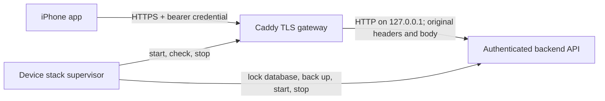
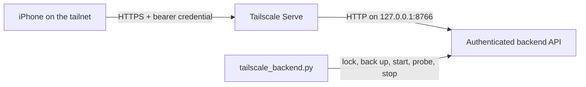

# Continuous job review

Review one company at a time. Stop when you want. Each card decision saves before the next card opens. The local queue records approved jobs and research requests. This app does not send applications or contact employers.

## Backend workflow v1

The backend now has durable task scheduling, explicit Apply decisions, feed refill,
application tracking, and structured questions and answers. The agent, LLM, and
Chrome interfaces are intentionally unimplemented. The default worker reports
`not_configured` and leaves tasks queued without executing them.

The [v1 contract](CONTRACT_V1.md) defines the iOS endpoints, data types, retry rules,
architecture, and worker boundary. [HTTP fixtures](fixtures/v1-http.json) contain
fictional request and response examples. A [ranked card fixture](fixtures/ranked-flashcard.json)
shows the ranker's text and job order. [Health fixtures](fixtures/health.json)
show the startup readiness response. [Device access fixtures](fixtures/auth.json)
show an authentication failure and a successful capability read. The iOS app is developed separately in
`job-review-ios/`; these backend changes do not switch its transport automatically.

The ranker selects and orders up to three jobs per company. It also writes the
card summary and each job's selection reason, work, fit, and gap. The backend
stores this text with the exact selected job versions. The iOS app owns rendering,
layout, typography, and interactions. It displays the supplied text and does not
generate its own explanation for the ranker's choices.

Generated text is separate from the original posting data. A published card
keeps its text and order when new rankings arrive. If a selected posting changes,
the whole ranked group becomes stale; its old summary is not reused for a
smaller group. Existing or curated cards have `content: null` and keep their
source text. Actual ranking and text generation remain unimplemented behind
`AgentRuntime.rank(context, lease)`.

The existing web UI and unversioned endpoints retain their manual behavior.
Approve saves a choice. Queue records a manual handoff. Neither action creates an
automatic Apply task. Only `/api/v1/decisions` with `action: "apply"` creates a
versioned application process. The process captures the exact approved posting.

The server schedules a refill check every five seconds. It requests work when
fewer than 10 company cards remain, with a target of 30 cards and a five-minute
cooldown. One active refill is allowed. New agent results need ranking before
publication. Feed delivery uses polling; APNs is not included.

The physical iPhone connection must use HTTPS and authenticated device access.
The optional device access mode requires a bearer credential on every request.
The backend still binds only to loopback HTTP. `device_stack.py` supervises the
backend and Caddy TLS gateway together. Deployment and the physical iPhone check
remain pending.

At startup, the server starts a background readiness check after it binds its
HTTP port. `GET /api/v1/health` reports storage health, Chrome attachment,
LinkedIn sign-in, a full job posting read, and the Explorer, Ranker, and
Application Agent sessions. The API remains available while these checks run or
fail. HTTP 200 means the API answered; only `health.ready: true` permits worker
dispatch. Saved decisions and answers can wait safely while workers are blocked.

The actual Chrome and agent probes are part of the unimplemented
`AgentRuntime.preflight(probe_id, lease)` interface. The default reports
`not_configured`; it does not claim that LinkedIn or any agent is ready. A future
adapter must read a current posting through the attached, signed-in Chrome
session and get a fresh response from each dedicated agent session. Stored
session IDs alone do not pass these checks.

A check has a 30-second deadline. A successful result is valid for five minutes.
Failed checks can retry after 30 seconds, and expired results need a new check.
The readiness probe uses the same durable browser lock as application and
exploration work. A timed-out probe cannot release that lock while it may still
be running. Restarting the server does not reuse a previous ready result.

To check scheduling against a disposable database:

```sh
python3 job-review/orchestrator.py --db /private/tmp/job-review-workflow-demo.sqlite3
```

This creates a queued refill and reports that the worker is not configured. It
does not crawl sources or send applications. Starting a new server loads v1;
an already running server must be restarted separately. Development tests do not
restart or migrate the live server.

Run the backend tests from the workspace root:

```sh
python3 -B -m unittest discover -s job-review -p 'test_*.py'
```

All test databases are temporary. HTTP tests require permission to bind an
ephemeral loopback port. The legacy JSON export remains unchanged; retain the
SQLite database to preserve the full v1 task, question, and process history.

Start the local app from the workspace root:

```sh
python3 job-review/start.py
```

Open <http://127.0.0.1:8766>. The database is `job-review/state/review.sqlite3`. Keep the complete `state/` directory when moving the app. Stop the server before copying a database backup, or use SQLite's backup API. A JSON export is available in the app and at `/api/export`; it contains choices and history, but no session token.

## iPhone access away from home

`device_stack.py` starts and supervises the authenticated backend and Caddy TLS
gateway as one foreground service. Remote deployment is not complete. No
production domain, certificate, or device credential has been provisioned, and
physical iPhone access remains unverified. The existing local mode is unchanged.
`start.py` and the browser UI remain local-only.



Caddy 2.11.7 is installed in the project at
[.tools/caddy/2.11.7/caddy](.tools/caddy/2.11.7/caddy). Its archive digest was
checked against the official release. The local
[verification receipt](.tools/caddy/2.11.7/verified-install.json) records the
source and digests. This is a macOS ARM64 binary, not a global installation.

The remaining deployment inputs are the confirmed HTTPS origin, a reachable
network route, a trusted PEM certificate chain, and its matching unencrypted
PEM private key. The key must be a regular file owned by the current user with
mode `0600`, not a symlink. Certificate issuance and renewal are not automated.
Caddy supports supplied certificate and key files; see its
[TLS reference](https://caddyserver.com/docs/caddyfile/directives/tls).

The origin must use a DNS hostname; literal IP origins cannot pass the gateway's
strict TLS SNI/Host check. DNS, firewall rules, NAT or CGNAT access, and keeping
the backend host awake are separate deployment work. A successful local HTTPS
probe does not prove reachability from an iPhone away from home.

### Private stack configuration

[device-stack.example.json](device-stack.example.json) is a configuration
template for the private file `job-review/state/device/stack.json`. It contains
no secrets and is not a deployment configuration. The private file must be
owned by the current user, have mode `0600`, and must not be a symlink. The schema
contains exactly `schema_version: 1`, `database`, and `gateway`; unknown fields
are rejected.

Relative paths use the private configuration file's directory, not the current
working directory. At `state/device/stack.json`, the template resolves these
paths:

| Configuration value | Resolved project path |
| --- | --- |
| `database: "../review.sqlite3"` | Existing `state/review.sqlite3` |
| `gateway.access_config: "access.json"` | `state/device/access.json` |
| `gateway.credential_file: "credential.txt"` | `state/device/credential.txt` |
| `gateway.cert_file: "fullchain.pem"` | `state/device/fullchain.pem` |
| `gateway.key_file: "private-key.pem"` | `state/device/private-key.pem` |
| `gateway.caddy: "../../.tools/caddy/2.11.7/caddy"` | `.tools/caddy/2.11.7/caddy` |

Absolute file paths also work. The template keeps the existing review database;
it does not create a replacement catalog or reset decisions. Its listener is
`127.0.0.1:8443`, which is for local verification. Deployment selects the intended
reachable interface and port. `gateway.backend_port` defaults to 8766,
`listen_address` to `127.0.0.1`, and `listen_port` to the public origin's port or
443. `caddy` defaults to a command on `PATH`. Optional `ca_file` adds a trusted CA
for checks without changing iPhone trust or disabling certificate verification.

Device credentials are generated with `device_access.py`. This command is an
operator reference, not a completed deployment. `jobs.example.com:8443` is a
placeholder for the confirmed origin; both output directories must already
exist:

```sh
python3 job-review/device_access.py create \
  --origin https://jobs.example.com:8443 \
  --config job-review/state/device/access.json \
  --credential-output job-review/state/device/credential.txt
```

The helper creates owner-only files and refuses existing destinations. The
access JSON contains only the credential hash. The separate text file contains
the bearer secret. The helper does not print the secret or accept it as a
command-line argument. The iOS app stores its credential in Keychain. Private
configuration, certificates, and credentials remain outside the example file.

### Check and run the complete stack

The check and run commands use the same private configuration:

```sh
python3 job-review/device_stack.py check --config job-review/state/device/stack.json
python3 job-review/device_stack.py run --config job-review/state/device/stack.json
```

`check` validates the private configuration, device credential, certificate
trust and hostname, matching key, and Caddy configuration. It opens no database
or network listener and does not require a running backend. Configuration
validation uses Caddy's [documented CLI](https://caddyserver.com/docs/command-line).

`run` validates the same inputs, locks the selected database for this stack,
and refuses an occupied backend port. Before starting the backend on an existing
database, it makes an online SQLite backup, including committed WAL contents,
and checks the backup with `PRAGMA quick_check`. Backups are retained in a
`backups/` directory beside the database with mode `0700`; each backup file has
mode `0600`. A failed backup stops startup. The existing database and saved
decisions remain in place.

The supervisor starts the authenticated backend and the real Caddy process. It
checks that an unauthenticated backend request gets 401 and an authenticated
request reports `remote_access: true`. It then verifies an authenticated request
through TLS, including certificate trust and hostname, before reporting
`API and TLS ready`. Worker readiness is reported separately. The agent adapters
remain unimplemented, so `not_configured` is expected even with a ready API.

A separate terminal can inspect the running stack without starting another:

```sh
python3 job-review/device_stack.py status --config job-review/state/device/stack.json
```

`status` verifies authenticated local HTTPS and reads the worker health report.
It does not establish Internet or physical iPhone reachability.

The stack stays in the foreground. Ctrl+C, SIGTERM, or a backend or gateway
failure stops both components. It removes temporary Caddy state and retains the
database and verified backups. A second stack for the same database cannot
start while the lock is held. This lock coordinates stack processes; it does not
manage an existing server started by `start.py`. An occupied port is an error,
not permission to replace a process. Do not stop a process using an unchecked
PID from a file.

The gateway serves API routes only. It uses TLS 1.2/1.3 and HTTP/1.1 or HTTP/2,
with no HTTP redirect, admin, or HTTP/3 listener. It limits request sizes and
timeouts, disables access logs, redacts request details from runtime logs, and
does not retry upstream requests. It preserves the public Host, bearer
credential, Origin, session token, and command body. See the
[Caddy reverse proxy reference](https://caddyserver.com/docs/caddyfile/directives/reverse_proxy).

Do not proxy the default local mode. The configured public origin must differ
from the backend's local Host aliases. The preserved public Host makes an
accidental restart in local mode fail closed with 403. `remote_access: true`
reports authentication configuration, not gateway reachability or worker
readiness. Connectivity checks must not create a test Apply decision in the real
database. Tests use temporary databases.

To rotate access, provision a new access configuration and credential pair,
restart the stack with them, and update the iOS Keychain credential for the same
origin. Keep pending commands, including their request IDs and exact bodies.
After authentication succeeds, obtain a current session token and retry the
original command unchanged. A 401 does not justify a new Apply request.

The individual `server.py` and `tls_gateway.py check|run` commands remain
available for development and diagnostics; their options are in the
[v1 contract](CONTRACT_V1.md#tls-gateway-boundary). Unlike `device_stack.py check`,
`tls_gateway.py check` requires a running authenticated backend. The stack
command is the combined lifecycle entry point.

Tailscale Serve is an optional alternative gateway. It supplies private tailnet
HTTPS using its assigned DNS name and requires Tailscale access on both devices.
It is not a backend dependency. Existing Serve configuration must be inspected
before changing a service, and its upstream must be the authenticated backend.
Public Funnel is outside this setup. See the
[Serve documentation](https://tailscale.com/docs/features/tailscale-serve) and
[CLI reference](https://tailscale.com/docs/reference/tailscale-cli/serve).

Run the full suite with the installed project binary to include real Caddy
integration tests. They also need `openssl` on `PATH` and are skipped if either
it or `JOB_REVIEW_CADDY` is absent. The HTTP/2 case requires a `curl` build with
HTTP/2 support:

```sh
JOB_REVIEW_CADDY="$PWD/job-review/.tools/caddy/2.11.7/caddy" python3 -B -m unittest discover -s job-review -p 'test_*.py'
```

## Tailscale Serve alternative

`tailscale_backend.py` supervises only the authenticated backend when Tailscale
Serve supplies HTTPS. The existing `device_stack.py` and Caddy route remain
available. Use one supervisor for a database at a time.



Configure Serve separately to forward the selected HTTPS origin to
`http://127.0.0.1:8766`. Set the same origin in the private device access file
and the iOS app. Tailscale identity headers do not replace the bearer credential.
The backend also checks the exact HTTPS `Origin` and session token on writes.
No secrets belong in the app bundle, URL, command arguments, or logs.

The commands below use private credential files provisioned separately with
`device_access.py`. Both files must be regular files owned by the current user
with mode `0600`; symbolic links are rejected. Commands take file paths, never
the credential text. Run them from the workspace root:

```sh
python3 job-review/tailscale_backend.py check \
  --db job-review/state/review.sqlite3 \
  --access-config job-review/state/device/tailscale-access.json \
  --credential-file job-review/state/device/tailscale-credential.txt \
  --port 8766

python3 job-review/tailscale_backend.py run \
  --db job-review/state/review.sqlite3 \
  --access-config job-review/state/device/tailscale-access.json \
  --credential-file job-review/state/device/tailscale-credential.txt \
  --port 8766

python3 job-review/tailscale_backend.py status \
  --db job-review/state/review.sqlite3 \
  --access-config job-review/state/device/tailscale-access.json \
  --credential-file job-review/state/device/tailscale-credential.txt \
  --port 8766
```

`check` validates authentication inputs without opening the database or a
listener. `run` takes the same database lock as `device_stack.py`, refuses an
occupied port before opening the database, and creates a verified SQLite backup
before migrations. The backup includes committed WAL data and remains after
shutdown. An absent database is created only when startup can proceed.

The server binds only to `127.0.0.1`. Startup verifies unauthenticated HTTP 401
and authenticated HTTP 200 responses. The worker remains disabled because the
agent adapters are deferred. Up to 16 request connections may run at once;
excess connections close, and socket reads have a ten-second idle timeout. The
API's existing request body limit still applies. Shutdown closes open request
sockets and waits for accepted requests before releasing the database lock.

`status` reads the local authenticated API. It does not prove that Tailscale
HTTPS, certificate validation, or an iPhone connection works. Verify those
separately against the actual HTTPS origin. The supervisor does not install,
start, stop, or change Tailscale. Serve configuration can outlive this foreground
process; stop or update Serve separately when changing its target.

Focused tests use fictional temporary databases and loopback sockets:

```sh
python3 -B -m unittest discover -s job-review -p 'test_tailscale_backend.py' -v
```

## Review a company

The main **Review** view shows one centered company card and up to three jobs. Each job shows its exact title, work setting, work, fit, and main gap. Open its details for pay and full source evidence. **Browse** opens the search, saved jobs, queue, and other views.

Drag or swipe the card left to exclude the company. Swipe right to approve only the checked jobs. The three labeled buttons provide the same actions, including **Find more**. A right swipe with no checked jobs cannot approve anything. Vertical scrolling, short drags, and gestures that start on a link or control do not save a decision.

- Pick exact jobs, then choose **Approve selected jobs**. Only those jobs move to Ready.
- Choose **Find more jobs** to request research for that company. Earlier job choices stay saved.
- Choose **Exclude company** to hide the company and cancel its queued work. Resolve started work first.

Nothing is selected for you. Picking a checkbox alone does not save an approval. A successful card action records all jobs shown as reviewed. Unselected jobs remain available in **All jobs** and **Inbox**. They are not rejected or approved. Use those views to change an earlier choice or add a note.

Review progress stays in the database across refreshes and server restarts. **Review last decision** opens that company's saved jobs. There is no requirement to review all companies in one session. New jobs can arrive while older jobs remain waiting.

## If a save fails

The app stays on the card until the server confirms the save. A stale card cannot save over newer data. Load its current details, check them, and make the choice again.

If the connection stops, a request may already have saved. Reconnect and select **Refresh feed**, then **Check card decision** or **Check queue request**. The app retries the same request ID and exact selection. The server returns the saved result without adding duplicate work. Do not create a different request to recover an uncertain save. The app keeps an unresolved request in browser storage across a reload.

Saved choices remain on the server when the app is offline. Save or discard any unsaved notes before making another decision.

## Add more research

Create a JSON file with a `companies` list. Each company needs its stable `id`, `name`, and a nonempty `jobs` list. Each job needs its exact `job_id`, exact `title`, and official HTTPS `url`. Preserve full source evidence in the posting data. Add `brief: {work, fit, gap}` for the short descriptions.

```sh
python3 job-review/import_catalog.py path/to/new-research.json
```

There is no fixed company or job count. Imports add new rows and update existing research. They never remove missing jobs or clear company exclusions. Stable IDs and normalized URLs prevent duplicate jobs. A URL cannot move silently to a different company. Different IDs for the same URL become aliases of the original job key.

New jobs appear in Review after **Refresh feed**. New arrivals come first. Each card shows up to three jobs from that company's latest unreviewed import, ordered by rank. More jobs appear on later cards. An unchanged job already handled on a card does not appear again.

Changes to title, URL, location, work arrangement, salary, level, or gaps reset an approval and mark queued snapshots stale. A pending job with changed facts can appear in Review again. Later and Pass choices remain in their saved views. Started and completed history remains. Rank and short-copy changes keep approvals and card progress. No server restart is needed after an import.

## Use the queue

Approval saves a job in **Ready**; it does not queue an application. Open Ready, select exact jobs, review the selection, and choose **Queue selected jobs**. Other jobs can remain unreviewed. Return to the chat to ask the agent to start that queue. A queue entry preserves the exact approved posting. Do not use an old snapshot after the posting changes.

The operator can record progress:

```sh
python3 job-review/import_catalog.py --queue-id QUEUE_ID --status in_progress
python3 job-review/import_catalog.py --queue-id QUEUE_ID --status needs_input --note 'Required answer is missing.'
python3 job-review/import_catalog.py --queue-id QUEUE_ID --status applied --note 'Official confirmation received; reference ABC123.'
python3 job-review/import_catalog.py --queue-id QUEUE_ID --status failed --note 'The form failed; no confirmation received.'
python3 job-review/import_catalog.py --queue-id RESEARCH_ID --status done --note 'Read the official board and imported the new roles.'
```

`applied`, `done`, `needs_input`, and `failed` require an evidence or outcome note. The operator must supply truthful evidence; this local app cannot verify an employer's confirmation. Starting or completing an application also checks the current posting against the approved snapshot. Failed, stale, cancelled, and completed records cannot reopen. A retry needs a new queue entry. Only queued work can cancel. Cancellation resets its approval. Exclusion cancels queued work and clears unqueued approvals. Resolve started work before exclusion.

## Migrate the dated review once

Before the final switch, stop the old server so it cannot accept more choices. Read the original dated decision directory at that time. Do not use a QA or temporary directory.

```sh
python3 job-review/import_catalog.py output/research/job-review-20-2026-10-08/app/data.json --migrate --decisions output/research/job-review-20-2026-10-08/decisions
python3 job-review/import_catalog.py job-review/initial-catalog.json
```

The first command preserves the old files. It migrates draft choices and submitted job snapshots. A submitted snapshot with a different catalog version is retained as stale. Only a draft saved after the submission can replace unqueued choices. Newer exclusions cancel old queued work while preserving its history. The second command adds concise copy. Migration is keyed by the resolved old catalog path and runs once. It refuses to overwrite companies already present in the new database.

When the card view is first installed, a separate one-time migration records earlier research choices as reviewed. It covers only jobs that existed and had not changed when the research request was made. Newer or edited jobs remain eligible for Review.

## Check changes

```sh
cd job-review
python3 -m unittest -v test_store.py test_server.py
node test_ui.js
```

Tests use temporary databases. HTTP tests bind an ephemeral loopback port. For manual UI checks, import a catalog into a separate database and serve it on port 8771:

```sh
python3 job-review/import_catalog.py job-review/initial-catalog.json --db /private/tmp/job-review-ui-test.sqlite3
python3 job-review/server.py --port 8771 --db /private/tmp/job-review-ui-test.sqlite3
```

In local mode, the server accepts writes only from its own loopback origin with its current session token. Device access mode also requires a bearer credential and the configured HTTPS origin. Every mutation runs in a SQLite transaction. Stale entity revisions return HTTP 409. Card and queue request IDs make a retry safe after a lost response. No employer network calls or application-submit endpoint exist.
